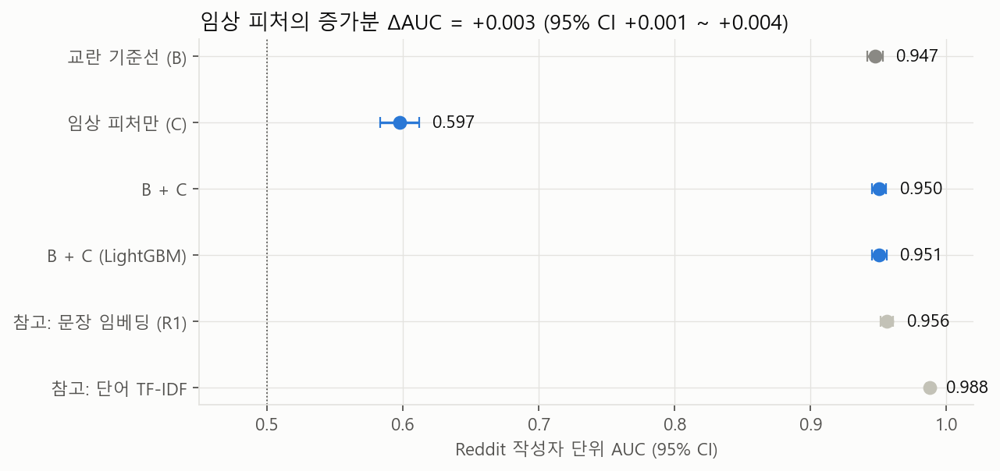
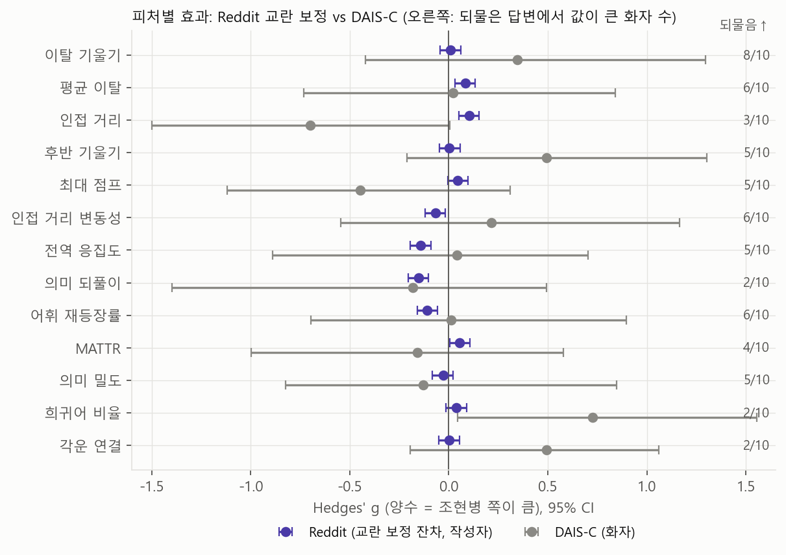
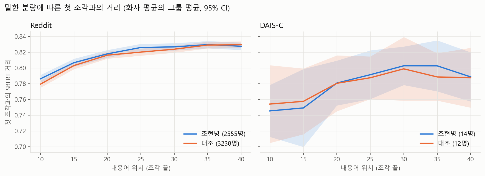

# MindCraft: 조현병 발화의 의미 이탈 정량화

> 최신 업데이트 (2026-10-23): v3 임상 피처 엔지니어링 결과와, 팀장님 Kaggle 노트북 최신본 점검 결과를 맨 위에 두었다. 그 아래는 10/16 진행 상황 보고다.

## v3. 임상 개념 기반 피처로 새 모델을 만들면 나아지는가 (2026-10-23)

질문: 형식적 사고장애(FTD)의 임상 개념에서 출발한 피처를 새로 만들면, 길이·주제·게시판 장르로 설명되는 부분을 넘어서는 정보를 줄 수 있는가. 계획은 결과를 보기 전에 [reports/v3/00_plan.md](reports/v3/00_plan.md)로 고정했고, 세부 결과는 [reports/v3/01_results.md](reports/v3/01_results.md)에 있다.

피처 13개 (모두 앞 40 내용어에서 계산): 이탈(이탈 기울기, 평균 이탈, 후반 기울기), 탈선(인접 거리, 최대 점프, 인접 거리 변동성), 연합 이완(전역 응집도), 보속(의미 되풀이, 어휘 재등장률), 사고 빈곤(MATTR, 의미 밀도), 단어 근사·신조어(희귀어 비율), 음운 연상(각운 연결). 문장 임베딩 벡터는 주제를 배우므로 주 모델에 넣지 않고 참고 모델(R1)로만 확인했다.



- 교란 기준선(글 길이, 주제 군집, 제목 질문형 여부, 제목 길이)만으로 AUC 0.947이 나온다. 이 데이터의 라벨이 사실상 게시판 구분이라는 뜻이다.
- 임상 피처 13개를 더하면 AUC가 0.003 오른다(95% CI +0.001~+0.004). 통계적으로는 0보다 크지만 실질적인 의미는 거의 없다.
- 참고 R1(문장 임베딩)은 Reddit에서 0.956이지만 DAIS-C에 그대로 적용하면 0.506이다. 임베딩은 주제를 배운다는 것을 확인했다.



- 교란을 보정한 Reddit 효과는 모두 작다(|g| 0.15 이하). 조현병 게시판 쪽이 전역 응집도·의미 되풀이가 낮고 인접 거리가 컸지만, 같은 게시판 안에서 본인 글과 가족·보호자 글을 비교하면 방향이 반대로 나온다(본인 글의 전역 응집도 g +0.23). 환자의 언어보다 게시판 글의 성격으로 보인다.
- DAIS-C 방향 일치는 13개 중 7개, Reddit 모델을 DAIS-C에 적용한 AUC는 0.58(95% CI 0.34~0.80)이다.
- 사전 기준 세 가지를 모두 통과한 피처는 평균 이탈과 의미 되풀이다. 다만 DAIS-C와 되물음 분석에서 유의하지 않고, 같은 게시판 안 비교에서는 방향이 뒤집혀 근거가 약하다.
- 탐색 수준의 단서: 면담자가 되물은 답변에서 이탈 기울기가 컸다(10명 중 8명, p = 0.02, 13개 보정 시 q = 0.25). DAIS-C 조현병군은 희귀어 비율이 높았다(g +0.73, 보정 후 q = 0.45).

결론: 이 Reddit 데이터에서는 피처를 새로 만들어도 게시판 차이를 넘어서는 조현병 언어 신호를 분리하기 어렵다. 피처 설계보다 데이터 구조(라벨이 게시판)의 한계다. 다음 진전에는 진단이 확인된 발화, 같은 조건에서 비교할 수 있는 설계, 더 큰 임상 표본이 필요하다.

---

## Kaggle 노트북 점검 (최신본 기준, 2026-10-23 갱신)

팀장님의 Kaggle Reddit 노트북([v1/colab_latest.ipynb](v1/colab_latest.ipynb))을 코드 그대로 옮겨 재현하고, 문제가 될 수 있는 부분을 하나씩 정리했을 때 AUC가 어떻게 바뀌는지 확인했다. 세부 수치와 재현 코드는 [reports/v2/03_notebook_audit.md](reports/v2/03_notebook_audit.md), `src/v2_notebook_audit.py`에 있다.

노트북이 하는 일: Reddit 글(제목+본문, 80~1,200단어 4,950개)에서 진단어를 "MASKTERM"으로 가리고, 피처 8개(TF-IDF 담화 지표 3개, MATTR, 평균 단어 길이, 1인칭·기능어·접속사 비율)를 계산해 작성자 단위 교차검증 로지스틱 회귀로 분류한다(AUC 0.782). 이어서 주제 매칭(0.725), 순열 검정, USE 임베딩, DAIS-C 방향 비교(8개 중 4개 일치)를 한다. 최신본에는 창 크기 민감도(10A, 20~60단어)와 앞 100단어 길이 통제(10B)가 추가됐다. 작성자 단위 교차검증, 결과를 골라내지 않는 민감도 분석, 한계 명시 등 설계는 탄탄하다.

### 확인한 문제와, 정리했을 때의 효과

| 문제 | 내용 | 정리했을 때 AUC |
|---|---|---|
| 제목과 가공된 본문이 섞임 | 본문은 데이터셋 제작자가 NLTK 불용어를 지운 상태이고 제목만 원문이다. 그래서 1인칭·기능어·접속사 비율이 대부분 제목에서 세어지고, 제목 문체는 게시판마다 다르다 | 제목만 빼면 0.782 → 0.729. 주제·길이를 통제한 10B에서 제목만 빼면 0.729 → 0.594 |
| 글 길이 차이 | 조현병 게시판 글이 짧다(중앙값 127 대 179단어). 길이 하나만으로 AUC 0.652 | 제목이 있으면 길이를 맞춰도 그대로(0.782). 제목을 뺀 뒤 길이까지 맞추면 0.709 → 0.647 |
| MASKTERM 치환 | 조현병 글 81%, 대조 3%에 8글자 표시가 들어가 평균 단어 길이를 부풀린다 | 치환 대신 삭제하면 0.782 → 0.765 |
| 10A·10B 견고성 확인 | 모든 설정에서 제목이 글 맨 앞에 들어가 위 문제가 그대로 남는다. 10A는 창이 커질수록 짧은 글이 빠져 표본이 달라지고(조현병 작성자 1,873명 → 1,072명), 창이 50% 겹친다 | 10B에서 제목만 빼면 0.594 |
| DAIS-C 원천 파일 | `Speaker Only_Raw`의 21AN11은 발화가 약 절반 빠져 있고 21UN11은 다른 텍스트가 섞여 있다 | v2부터 태그 포함 파일 사용 |
| 두 데이터의 가공 불일치 | Reddit 본문에는 불용어가 없고 DAIS-C에는 있어, 같은 피처가 서로 다른 것을 잰다 | v2부터 두 데이터에 같은 가공 적용 |
| DAIS-C 전사 전체 사용 | 면담자가 바꾼 주제까지 참여자 이탈로 잡히고, 길이도 다르다(2,900 대 1,616단어) | v2부터 질문-답변 단위, 길이 통일 |

제목, 길이, MASKTERM을 모두 정리하면 노트북 AUC는 0.782에서 0.647이 된다. 이 세 가지는 조현병 증상이 아니라 데이터 수집·가공 방식에서 생긴 차이다. 남는 0.647은 본문 어휘 차이인데, 같은 조건을 맞춘 v2(SBERT, 0.54)와 v3(교란 기준선 대비 +0.003)에서 게시판 장르 차이 이상의 신호는 확인되지 않았다.

데이터셋 설명에는 "preprocessing"이라는 말만 있어 본문이 미리 가공됐다는 사실을 알기 어렵다. 이 데이터셋을 쓰는 다른 연구에서도 같은 일이 생길 수 있으므로, 우리 연구에서는 데이터셋의 특성을 확인한 방법론적 발견으로 정리할 수 있다.

### 노트북을 고친다면

1. 제목을 빼고 본문만 쓰거나, 제목에도 본문과 같은 NLTK 불용어 제거를 한다.
2. 진단어는 다른 단어로 바꾸지 말고 지운다.
3. 길이 통제는 제목을 뺀 본문 기준으로, 모든 글이 정확히 같은 길이가 되게 한다.
4. DAIS-C는 태그 포함 파일을 쓰고, Reddit과 같은 불용어 제거를 적용하고, 질문-답변 단위로 나눈다.

---

> 10/16 진행 상황 (2026-10-16 기준). 지난 보고(10/02, [v1/reports/SUMMARY_2026-10-02.md](v1/reports/SUMMARY_2026-10-02.md)) 이후, 팀장님의 Kaggle Reddit 분석(Colab 노트북 v5.1, [v1/colab_v5_1.ipynb](v1/colab_v5_1.ipynb))을 바탕으로 두 데이터를 함께 분석한 내용이다. 저장소 사용법은 맨 아래에 있다.

Reddit에서 지표를 찾고(발견), 같은 지표를 DAIS-C 임상 면담에 그대로 적용해 확인하는(검증) 구조로 진행했다.

## 0. 처음 보는 분을 위한 용어

| 용어 | 뜻 |
|---|---|
| 이탈 기울기 | 글이나 말을 조각으로 나눠, 첫 조각에서 의미가 얼마나 빠르게 멀어지는지를 나타낸 값. 이 연구의 핵심 지표 |
| SBERT | 문장의 의미를 숫자 벡터로 바꾸는 모델. 두 조각의 의미가 다를수록 거리가 크다 |
| AUC | 두 그룹을 얼마나 잘 구분하는지. 0.5는 동전 던지기, 1.0은 완벽 |
| g (효과 크기) | 두 그룹 평균 차이를 표준편차 단위로 나타낸 값. 0.2 작음, 0.5 중간, 0.8 큼 |
| 95% CI | 효과 크기가 있을 법한 범위. 0을 포함하면 "차이가 있다"고 말하기 어렵다 |

## 1. Kaggle 노트북 검토에서 배운 점

노트북의 좋은 설계는 그대로 가져왔다. 같은 작성자의 글이 학습과 평가에 섞이지 않게 작성자 단위로 나눈 교차검증, 진단 단어 가리기, 라벨 순열 검정, 주제 매칭이다.

새로 확인한 점은 두 가지다.

1. Reddit 데이터셋 본문은 이미 가공된 상태다. Kaggle API로 확인하니 받아 둔 파일이 원본과 바이트 단위까지 같다. 본문(selftext)은 데이터셋 제작자가 소문자로 바꾸고, 문장부호를 지우고, NLTK 불용어 198개를 모두 지워 둔 상태라 I, my, the, and 같은 단어가 하나도 없다. 제목만 원래 문장이다. 데이터셋 설명에는 "preprocessing"이라는 말만 있어서 단어 빈도를 직접 세 보고서야 알 수 있었다.
2. DAIS-C의 `Speaker Only_Raw` 폴더는 두 명(21AN11, 21UN11)의 텍스트가 원본 대화 파일과 맞지 않는다. 그래서 태그가 포함된 파일을 쓴다.

## 2. 새 분석(v2) 설계

| 항목 | 방식 | 이유 |
|---|---|---|
| 가공 | 두 데이터 모두 소문자, 문장부호 제거, NLTK 불용어 제거, 더듬기(er/erm) 제거, 진단 단어 제거 | Reddit 본문이 이미 이 상태라 DAIS-C를 같은 조건으로 맞춤 |
| 길이 | 내용어(불용어를 뺀 단어) 앞 40개를 5개씩 8조각으로 나눠 계산 | 글 길이가 다르면 지표 값이 달라지므로 모든 단위를 같은 길이로 맞춤 |
| 의미 거리 | SBERT (all-MiniLM-L6-v2) | 계획서의 핵심 방법. 단어가 아니라 의미를 비교함 |
| DAIS-C 단위 | 면담자 질문 하나에 대한 답변 하나 | 면담자가 주제를 바꾼 것을 참여자의 이탈로 잘못 세지 않기 위함 |
| Reddit 표본 | 조현병 게시판 글 중 가족·보호자가 쓴 글 제외 | 환자 본인의 언어를 보기 위함. 규칙 기반 1차 분류 |
| 검증 단위 | Reddit은 작성자, DAIS-C는 화자 | 같은 사람의 데이터가 여러 번 세어지는 것을 막음 |

지표는 6개다. 핵심은 이탈 기울기이고, 보조로 평균 이탈, 인접 조각 거리, 후반 기울기(출발 부분을 뺀 이탈), 어휘 재등장률, MATTR(어휘 다양성)을 쓴다.

결과를 보기 전에 분석 계획서([reports/00_analysis_plan.md](reports/v2/00_analysis_plan.md))를 먼저 저장소에 올렸다. 결과를 본 뒤 방법을 바꾸지 않았다는 근거를 남기기 위해서다. 이후 추가한 분석도 실행 전에 계획서의 변경 기록에 먼저 적었다.

## 3. 주 분석 결과


Reddit (작성자 5,793명)
- 이탈 기울기: g −0.05 (95% CI −0.10~0.00). 두 그룹 차이가 없다.
- 6개 지표로 분류한 AUC: 0.54. 우연보다는 높지만(순열 검정 p = 0.005) 구분력은 매우 낮다.
- 인접 조각 거리만 조현병 게시판 쪽이 조금 컸다(g 0.14).

DAIS-C (26명)
- 이탈 기울기: g +0.35 (95% CI −0.42~1.30). 범위가 넓어 차이를 말하기 어렵고, Reddit과 방향도 다르다.
- 시작 질문, 성별, 질문 길이를 보정한 모형에서는 조현병군의 기울기가 컸다(p = 0.024). 다만 26명 규모이고, 녹음 방식처럼 보정할 수 없는 차이가 남아 있다.
- Reddit에서 학습한 모델을 DAIS-C에 그대로 적용한 AUC는 0.39다.



연구자 표시와의 비교
- DAIS-C 저자들이 "담화 추적 어려움(DT)"을 표시한 구간에서, 같은 사람 안의 인접 거리가 커지는 경향은 있었지만 뚜렷하지 않았다(12명 중 8명, p = 0.34).


계획서 기준 판정은 "Reddit 발견 미지지, DAIS-C 재현 안 됨"이다. 세부 수치는 [reports/01_results.md](reports/v2/01_results.md).

## 4. 추가 확인 (탐색 분석)

| 분석 | 내용 | 결과 |
|---|---|---|
| E1 | 조현병 게시판 안에서 본인 글과 가족·보호자 글 비교. 게시판이 같아 장르가 맞춰짐 | 이탈 기울기 차이 없음. 인접 거리는 오히려 본인 글이 작음 |
| E2 | DAIS-C 답변을 주제별로 묶어 같은 주제끼리 비교 | 데이터가 적고 주제가 그룹과 거의 겹쳐 제대로 묶이지 않음. 참고용 |
| E3 | Reddit 글을 주제 5개로 묶어 주제를 보정 | 이탈 기울기 차이 여전히 없음. 인접 거리는 조현병 게시판이 큼 |
| E4 | E1을 1인칭 축약어(im, ive 등)를 빼고 다시 계산 | E1에서 보였던 본인 글의 반복 증가, 어휘 감소가 절반 이하로 줄어 유의하지 않음 |
| E5 | DAIS-C에서 면담자가 "what do you mean?"처럼 되물은 답변과 같은 사람의 다른 답변 비교 | 되물은 답변의 이탈 기울기가 큼 (10명 중 8명, p = 0.020) |


E1과 E3를 함께 보면, Reddit의 인접 거리 차이는 환자의 언어라기보다 조현병 게시판 글의 성격(증상 나열, 질문, 경험담)에서 왔을 가능성이 크다. 같은 게시판의 가족·보호자 글에서도 같은 차이가 나타나기 때문이다.

E5는 이번에 얻은 가장 긍정적인 단서다. 같은 사람 안에서 비교하므로 그룹 간 차이가 섞이지 않고, "듣는 사람이 실제로 따라가기 어려워했다"는 사실을 기준으로 삼는다. 이탈 지표가 높은 답변일수록 면담자가 되물었다는 것은 이 지표가 실제 소통의 어려움과 관련이 있다는 뜻이다. 다만 되물은 답변이 24개뿐이라 예비 결과로 본다. 세부 수치는 [reports/02_exploratory.md](reports/v2/02_exploratory.md).

## 5. 노트북 AUC 0.78은 어디서 왔나 (E6)

최신본 기준으로 다시 점검한 내용을 맨 위 "Kaggle 노트북 점검" 절로 옮겼다.

## 6. 지금까지의 결론

1. 조현병 그룹이 대조군보다 "말할수록 더 멀어진다"는 그룹 차이는 Reddit, DAIS-C 어디서도 확인되지 않았다.
2. Reddit 데이터셋은 본문만 미리 가공돼 있어, 제목과 본문을 함께 쓰면 게시판 문체가 지표에 섞인다. 제목을 빼고 글 길이를 맞추면 노트북의 AUC는 0.78에서 0.65로 내려간다.
3. 대신 같은 사람 안에서는, 이탈 지표가 높은 답변일수록 면담자가 되물었다. 지표 자체가 의미 있다는 첫 단서다.

## 7. 다음 단계 (제안)

- 작성 주체 확인: Reddit 조현병 게시판 글 100개를 팀원이 직접 "본인 / 가족·보호자 / 알 수 없음"으로 표시하면, 규칙 분류의 정확도를 확인하고 E1을 확정 결과로 올릴 수 있다. 파일(`data/processed/reddit_source_check.csv`)은 원문이 들어 있어 저장소에는 올리지 않았다. 필요하면 따로 전달한다.
- 되묻기 확장: 면담자 발화 전체를 직접 보고 되묻기 여부를 표시하면 E5의 표본을 늘릴 수 있다.
- 10/24 발표 구성 논의: (1) 데이터셋 특성 확인과 그 영향, (2) 그룹 차이가 확인되지 않은 결과, (3) 되묻기와 지표의 관련성 순서로 구성하는 안을 제안한다.

---

# 저장소 안내

## 폴더

| 경로 | 내용 |
|---|---|
| `config.yaml` | 설정 하나로 관리 |
| `src/text.py`, `prep_daisc.py`, `prep_reddit.py` | 공통 전처리 (두 코퍼스 같은 가공, 단위 구축) |
| `src/v2_*.py` | v2: SBERT 이탈 지표 분석, 탐색 분석, 팀 노트북 점검 |
| `src/v3_*.py` | v3: 임상 피처 13개와 교란 기준선 모델 |
| `reports/v2/`, `reports/v3/` | 버전별 계획(00), 결과(01~), 그림 |
| `data/raw/`, `data/processed/` | 원본과 산출물 (git 제외) |
| `v1/` | 이전 작업 보관 (DAIS-C 단독 분석, LLM 증강, 팀 Colab 노트북 v5.1과 최신본) |

## 데이터

- DAIS-C: UK Data Service ReShare 855021 (CC BY-SA 4.0). `data/raw/dais-c/`에 둔다.
- Reddit: Kaggle "Reddit-Based Schizophrenia Detection Dataset" (S. S. Sachidhanand, CC BY-NC 4.0). `data/raw/reddit/`에 둔다.

## 실행 순서

```
# 공통 전처리
python src/prep_daisc.py           # DAIS-C 질문-답변 단위, 판단 태그 위치  -> data/processed/daisc_units.parquet
python src/prep_reddit.py          # Reddit 정리, 작성 주체 1차 분류         -> data/processed/reddit_units.parquet
# v2
python src/v2_features.py          # 앞 40 내용어 SBERT 지표 (30·60 민감도)  -> features.parquet, chunks.parquet
python src/v2_analyze.py           # 계획서의 분석 1-3, 민감도               -> reports/v2/01_results.md, fig1-3
python src/v2_explore.py           # 탐색 분석 E1-E5                          -> reports/v2/02_exploratory.md, fig4
python src/v2_notebook_audit.py    # 팀 노트북 AUC 재현·점검 (E6)            -> reports/v2/03_notebook_audit.md
# v3
python src/v3_features.py          # 임상 피처 13개, 교란 기준선 변수         -> data/processed/v3_features.parquet
python src/v3_model.py             # M1-M4, 참고 R1                           -> reports/v3/01_results.md, fig1-2
```
