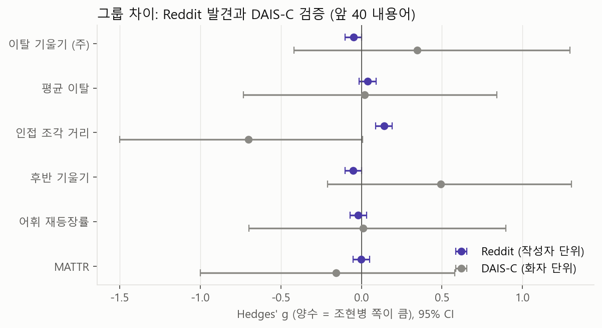
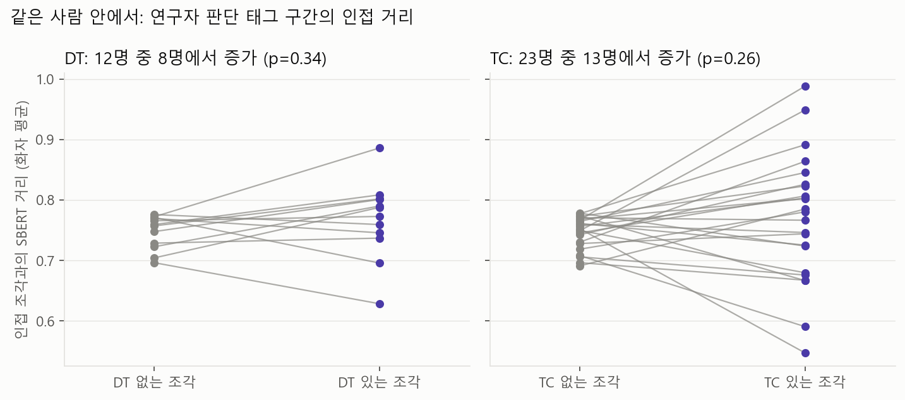
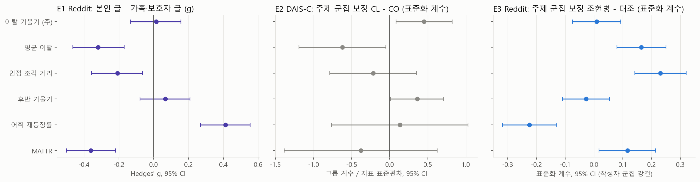

# MindCraft: 조현병 발화의 의미 이탈 정량화

> 최근 진행 상황 (2026-10-16 기준). 지난 보고(10/02, [v1/reports/SUMMARY_2026-10-02.md](v1/reports/SUMMARY_2026-10-02.md)) 이후, 팀장님의 Kaggle Reddit 분석(Colab 노트북 v5.1, [v1/colab_v5_1.ipynb](v1/colab_v5_1.ipynb))을 바탕으로 두 데이터를 함께 분석한 내용이다. 저장소 사용법은 맨 아래에 있다.

Reddit에서 지표를 찾고(발견), 같은 지표를 DAIS-C 임상 면담에 그대로 적용해 확인하는(검증) 구조로 진행했다.

## 0. 처음 보는 분을 위한 용어

| 용어 | 뜻 |
|---|---|
| 이탈 기울기 | 글이나 말을 조각으로 나눠, 첫 조각에서 의미가 얼마나 빠르게 멀어지는지를 나타낸 값. 이 연구의 핵심 지표 |
| SBERT | 문장의 의미를 숫자 벡터로 바꾸는 모델. 두 조각의 의미가 다를수록 거리가 크다 |
| AUC | 두 그룹을 얼마나 잘 구분하는지. 0.5는 동전 던지기, 1.0은 완벽 |
| g (효과 크기) | 두 그룹 평균 차이를 표준편차 단위로 나타낸 값. 0.2 작음, 0.5 중간, 0.8 큼 |
| 95% CI | 효과 크기가 있을 법한 범위. 0을 포함하면 "차이가 있다"고 말하기 어렵다 |

## 1. Kaggle 노트북 검토에서 배운 점

노트북의 좋은 설계는 그대로 가져왔다. 같은 작성자의 글이 학습과 평가에 섞이지 않게 작성자 단위로 나눈 교차검증, 진단 단어 가리기, 라벨 순열 검정, 주제 매칭이다.

새로 확인한 점은 두 가지다.

1. Reddit 데이터셋 본문은 이미 가공된 상태다. Kaggle API로 확인하니 받아 둔 파일이 원본과 바이트 단위까지 같다. 본문(selftext)은 데이터셋 제작자가 소문자로 바꾸고, 문장부호를 지우고, NLTK 불용어 198개를 모두 지워 둔 상태라 I, my, the, and 같은 단어가 하나도 없다. 제목만 원래 문장이다. 데이터셋 설명에는 "preprocessing"이라는 말만 있어서 단어 빈도를 직접 세 보고서야 알 수 있었다.
2. DAIS-C의 `Speaker Only_Raw` 폴더는 두 명(21AN11, 21UN11)의 텍스트가 원본 대화 파일과 맞지 않는다. 그래서 태그가 포함된 파일을 쓴다.

## 2. 새 분석(v2) 설계

| 항목 | 방식 | 이유 |
|---|---|---|
| 가공 | 두 데이터 모두 소문자, 문장부호 제거, NLTK 불용어 제거, 더듬기(er/erm) 제거, 진단 단어 제거 | Reddit 본문이 이미 이 상태라 DAIS-C를 같은 조건으로 맞춤 |
| 길이 | 내용어(불용어를 뺀 단어) 앞 40개를 5개씩 8조각으로 나눠 계산 | 글 길이가 다르면 지표 값이 달라지므로 모든 단위를 같은 길이로 맞춤 |
| 의미 거리 | SBERT (all-MiniLM-L6-v2) | 계획서의 핵심 방법. 단어가 아니라 의미를 비교함 |
| DAIS-C 단위 | 면담자 질문 하나에 대한 답변 하나 | 면담자가 주제를 바꾼 것을 참여자의 이탈로 잘못 세지 않기 위함 |
| Reddit 표본 | 조현병 게시판 글 중 가족·보호자가 쓴 글 제외 | 환자 본인의 언어를 보기 위함. 규칙 기반 1차 분류 |
| 검증 단위 | Reddit은 작성자, DAIS-C는 화자 | 같은 사람의 데이터가 여러 번 세어지는 것을 막음 |

지표는 6개다. 핵심은 이탈 기울기이고, 보조로 평균 이탈, 인접 조각 거리, 후반 기울기(출발 부분을 뺀 이탈), 어휘 재등장률, MATTR(어휘 다양성)을 쓴다.

결과를 보기 전에 분석 계획서([reports/00_analysis_plan.md](reports/00_analysis_plan.md))를 먼저 저장소에 올렸다. 결과를 본 뒤 방법을 바꾸지 않았다는 근거를 남기기 위해서다. 이후 추가한 분석도 실행 전에 계획서의 변경 기록에 먼저 적었다.

## 3. 주 분석 결과



Reddit (작성자 5,793명)
- 이탈 기울기: g −0.05 (95% CI −0.10~0.00). 두 그룹 차이가 없다.
- 6개 지표로 분류한 AUC: 0.54. 우연보다는 높지만(순열 검정 p = 0.005) 구분력은 매우 낮다.
- 인접 조각 거리만 조현병 게시판 쪽이 조금 컸다(g 0.14).

DAIS-C (26명)
- 이탈 기울기: g +0.35 (95% CI −0.42~1.30). 범위가 넓어 차이를 말하기 어렵고, Reddit과 방향도 다르다.
- 시작 질문, 성별, 질문 길이를 보정한 모형에서는 조현병군의 기울기가 컸다(p = 0.024). 다만 26명 규모이고, 녹음 방식처럼 보정할 수 없는 차이가 남아 있다.
- Reddit에서 학습한 모델을 DAIS-C에 그대로 적용한 AUC는 0.39다.


연구자 표시와의 비교
- DAIS-C 저자들이 "담화 추적 어려움(DT)"을 표시한 구간에서, 같은 사람 안의 인접 거리가 커지는 경향은 있었지만 뚜렷하지 않았다(12명 중 8명, p = 0.34).



계획서 기준 판정은 "Reddit 발견 미지지, DAIS-C 재현 안 됨"이다. 세부 수치는 [reports/01_results.md](reports/01_results.md).

## 4. 추가 확인 (탐색 분석)

| 분석 | 내용 | 결과 |
|---|---|---|
| E1 | 조현병 게시판 안에서 본인 글과 가족·보호자 글 비교. 게시판이 같아 장르가 맞춰짐 | 이탈 기울기 차이 없음. 인접 거리는 오히려 본인 글이 작음 |
| E2 | DAIS-C 답변을 주제별로 묶어 같은 주제끼리 비교 | 데이터가 적고 주제가 그룹과 거의 겹쳐 제대로 묶이지 않음. 참고용 |
| E3 | Reddit 글을 주제 5개로 묶어 주제를 보정 | 이탈 기울기 차이 여전히 없음. 인접 거리는 조현병 게시판이 큼 |
| E4 | E1을 1인칭 축약어(im, ive 등)를 빼고 다시 계산 | E1에서 보였던 본인 글의 반복 증가, 어휘 감소가 절반 이하로 줄어 유의하지 않음 |
| E5 | DAIS-C에서 면담자가 "what do you mean?"처럼 되물은 답변과 같은 사람의 다른 답변 비교 | 되물은 답변의 이탈 기울기가 큼 (10명 중 8명, p = 0.020) |



E1과 E3를 함께 보면, Reddit의 인접 거리 차이는 환자의 언어라기보다 조현병 게시판 글의 성격(증상 나열, 질문, 경험담)에서 왔을 가능성이 크다. 같은 게시판의 가족·보호자 글에서도 같은 차이가 나타나기 때문이다.

E5는 이번에 얻은 가장 긍정적인 단서다. 같은 사람 안에서 비교하므로 그룹 간 차이가 섞이지 않고, "듣는 사람이 실제로 따라가기 어려워했다"는 사실을 기준으로 삼는다. 이탈 지표가 높은 답변일수록 면담자가 되물었다는 것은 이 지표가 실제 소통의 어려움과 관련이 있다는 뜻이다. 다만 되물은 답변이 24개뿐이라 예비 결과로 본다. 세부 수치는 [reports/02_exploratory.md](reports/02_exploratory.md).

## 5. 노트북 AUC 0.78은 어디서 왔나 (E6)

노트북 코드를 그대로 옮겨 다시 돌리니 AUC 0.782가 똑같이 나왔다. 그다음 조건을 하나씩 바꿔 봤다.

| 조건 | AUC |
|---|---|
| 노트북 그대로 | 0.782 |
| 진단 단어를 "MASKTERM"으로 바꾸는 대신 삭제 | 0.765 |
| 삭제 + 본문 길이를 80단어로 고정 (제목 포함) | 0.762 |
| 삭제 + 제목 제외 (본문 길이 그대로) | 0.709 |
| 삭제 + 제목 제외 + 본문 길이 80단어로 고정 | 0.631 |

제목과 길이가 함께 작용했다. 제목이 있으면 길이를 맞춰도 AUC가 그대로였고, 제목을 빼면 0.71로 내려간 뒤 길이까지 맞추면 0.63이 됐다. 제목이 있을 때는 제목 문체가 신호를 주도하고, 제목이 빠지면 본문 길이 차이가 남은 신호의 큰 부분을 차지한다는 뜻이다. 본문에는 불용어가 거의 없고 제목에만 있으므로, 1인칭 비율과 기능어 비율은 대부분 제목의 문체를 재게 된다. 제목 문체는 게시판마다 다르다. 예를 들어 연애 게시판 제목은 "My (24F) boyfriend..."처럼 1인칭으로 시작하는 경우가 많다. 반면 이탈 기울기는 제목을 빼도 단독 AUC가 0.65에서 0.64로 거의 그대로여서, 이 지표에는 제목의 영향이 작았다.

데이터셋 설명만으로는 본문이 가공돼 있다는 것을 알기 어렵기 때문에, 이 데이터셋을 쓰는 다른 연구에서도 같은 일이 생길 수 있다. 우리 연구에서는 이것을 데이터셋의 특성을 확인한 방법론적 발견으로 정리할 수 있다. 세부 수치는 [reports/03_notebook_audit.md](reports/03_notebook_audit.md).

## 6. 지금까지의 결론

1. 조현병 그룹이 대조군보다 "말할수록 더 멀어진다"는 그룹 차이는 Reddit, DAIS-C 어디서도 확인되지 않았다.
2. Reddit 데이터셋은 본문만 미리 가공돼 있어, 제목과 본문을 함께 쓰면 게시판 문체가 지표에 섞인다. 제목을 빼고 글 길이를 맞추면 노트북의 AUC는 0.78에서 0.63으로 내려간다.
3. 대신 같은 사람 안에서는, 이탈 지표가 높은 답변일수록 면담자가 되물었다. 지표 자체가 의미 있다는 첫 단서다.

## 7. 다음 단계 (제안)

- 작성 주체 확인: Reddit 조현병 게시판 글 100개를 팀원이 직접 "본인 / 가족·보호자 / 알 수 없음"으로 표시하면, 규칙 분류의 정확도를 확인하고 E1을 확정 결과로 올릴 수 있다. 파일(`data/processed/reddit_source_check.csv`)은 원문이 들어 있어 저장소에는 올리지 않았다. 필요하면 따로 전달한다.
- 되묻기 확장: 면담자 발화 전체를 직접 보고 되묻기 여부를 표시하면 E5의 표본을 늘릴 수 있다.
- 10/24 발표 구성 논의: (1) 데이터셋 특성 확인과 그 영향, (2) 그룹 차이가 확인되지 않은 결과, (3) 되묻기와 지표의 관련성 순서로 구성하는 안을 제안한다.

---

# 저장소 안내

## 폴더

| 경로 | 내용 |
|---|---|
| `config.yaml` | 설정 하나로 관리 |
| `src/` | v2 코드 |
| `reports/` | 분석 계획(00), 주 분석(01), 탐색 분석(02), 노트북 점검(03), 그림 |
| `data/raw/`, `data/processed/` | 원본과 산출물 (git 제외) |
| `v1/` | 이전 작업 보관 (DAIS-C 단독 분석, LLM 증강, 팀 Colab 노트북) |

## 데이터

- DAIS-C: UK Data Service ReShare 855021 (CC BY-SA 4.0). `data/raw/dais-c/`에 둔다.
- Reddit: Kaggle "Reddit-Based Schizophrenia Detection Dataset" (S. S. Sachidhanand, CC BY-NC 4.0). `data/raw/reddit/`에 둔다.

## 실행 순서

```
python src/prepare_daisc.py    # DAIS-C 질문-답변 단위, 판단 태그 위치  -> data/processed/daisc_units.parquet
python src/prepare_reddit.py   # Reddit 정리, 작성 주체 1차 분류         -> data/processed/reddit_units.parquet
python src/features.py         # 앞 40 내용어 SBERT 지표 (30·60 민감도)  -> features.parquet, chunks.parquet
python src/analyze.py          # 계획서의 분석 1-3, 민감도               -> reports/01_results.md, fig1-3
python src/explore.py          # 탐색 분석 E1-E5 (계획서 변경 기록)     -> reports/02_exploratory.md, fig4
python src/audit_notebook.py   # 팀 노트북 AUC 재현·점검 (E6)            -> reports/03_notebook_audit.md
```
