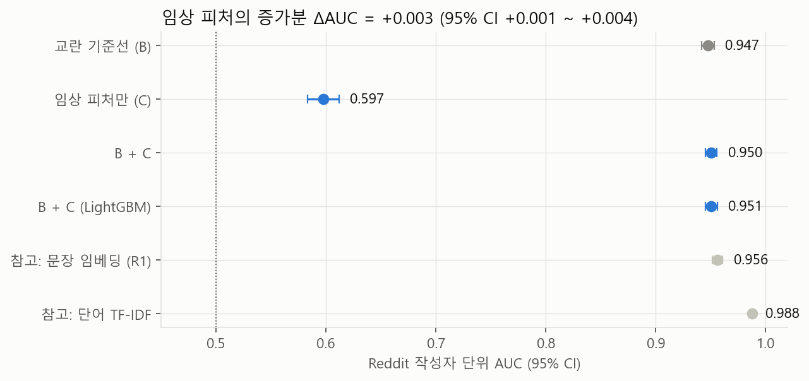
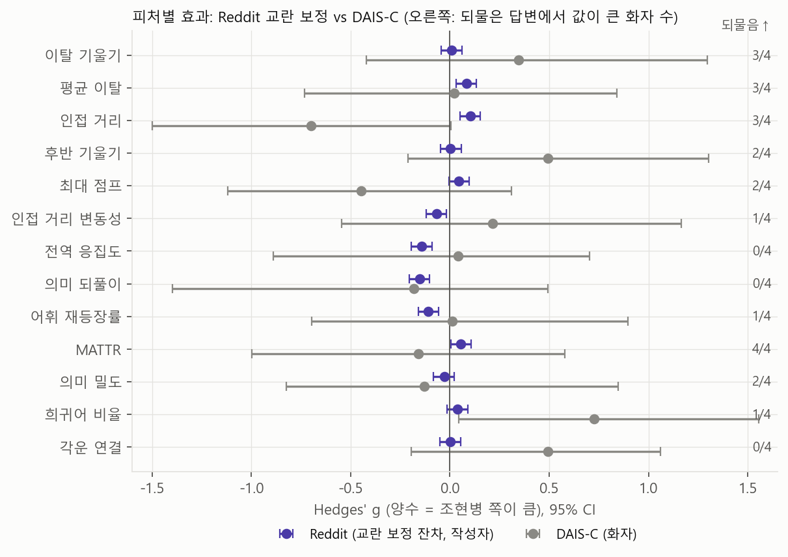

# 페르소나 모델 이전 작업 (v1~v4, 2026-10-01~11-08)

실제 데이터(DAIS-C, Reddit) 분석과 TLC 합성 발화로 지표 세트를 만든 과정. 지금 하는 페르소나 모델은 main 브랜치의 `schizophrenia/persona/`에 있다. 코드는 이 폴더 기준으로 실행한다(`cd before_persona`).

## 최종 정리 (2026-10-23): 지금 데이터로 알 수 있는 것과 없는 것

조현병 환자의 말이 대화가 진행될수록 주제에서 더 빨리 멀어지는지(이탈 기울기)를 텍스트로 측정하고, 이를 감별 모델로 만들 수 있는지 확인했다. 사용한 데이터는 DAIS-C(영국 임상 면담 전사)와 Kaggle Reddit 데이터셋이다. 결과를 보기 전에 분석 계획을 저장소에 먼저 올렸고, 이후 추가한 분석도 실행 전에 기록했다.

### 한 줄 결론

지금 가진 두 데이터로는 "조현병 환자의 말이 더 빨리 이탈한다"는 그룹 차이를 확인할 수 없었다. 높게 나왔던 분류 성능(AUC 0.78)은 대부분 데이터 수집·가공 방식에서 생긴 차이였다. 같은 사람 안에서 면담자가 되물은 답변의 이탈 기울기가 컸다는 예비 결과도 있었으나, 되물음 판정 규칙이 "I know what you mean" 같은 맞장구와 "sorry to hear" 같은 말까지 되물음으로 세고 있었다. 실제 되물음만 세면 5개(화자 4명)뿐이라 검정할 수 없다(2026-10-28 수정).

### 1. 데이터별 한계

| 데이터 | 한계 | 영향 |
|---|---|---|
| DAIS-C (조현병 15명, 대조 13명) | 규모가 작다. 녹음 방식(조현병군 전화·대면, 대조군 전원 화상통화), 성별(조현병군 남 13·여 3, 대조군 남 3·여 12), 면담 시작 질문이 그룹과 겹친다 | 그룹 차이가 질환 때문인지 다른 조건 때문인지 가를 수 없다. 효과 크기의 신뢰구간이 매우 넓다 |
| DAIS-C 파일 | `Speaker Only_Raw` 폴더의 21AN11은 발화가 약 절반 빠져 있고 21UN11은 다른 텍스트가 섞여 있다. 타임스탬프 파일은 27명 중 21명이 전사와 턴 수가 맞지 않는다 | 태그 포함 파일을 써야 한다. 말 속도 분석은 할 수 없다 |
| DAIS-C 태그 | 연구자 판단 태그(DT 등)를 붙인 절차, 맹검 여부, 평가자 일치도가 공개되지 않았다 | 정답으로 쓰기 어렵고 참고 기준으로만 쓸 수 있다 |
| Reddit 라벨 | 라벨이 진단이 아니라 게시판이다(조현병 게시판 대 농담·연애·육아 게시판). 조현병 게시판에는 가족·보호자 글도 섞여 있다 | 모델이 조현병이 아니라 게시판을 구분할 수 있다 |
| Reddit 본문 | 데이터셋 제작자가 본문만 소문자화, 문장부호 제거, NLTK 불용어 제거를 해 두었고 제목은 원문이다. 데이터셋 설명에는 "preprocessing"이라는 말만 있다 | 제목과 본문을 섞어 쓰면 제목 문체가 피처에 섞인다. 1인칭·기능어 같은 피처는 본문에서 계산할 수 없다 |
| Reddit 길이 | 조현병 게시판 글이 짧다(중앙값 127 대 179단어) | 글 길이 하나만으로 AUC 0.65가 나온다 |

### 2. 분석 과정에서 확인한 문제와 그 영향

| 문제 | 확인한 내용 |
|---|---|
| LLM 합성 데이터 증강 | 세 번 시도했지만 판별기가 실제와 합성을 AUC 0.93~0.999로 구분했다. 합성 조현병 발화는 실제에 없는 이탈을 과장했다(d 0.48, 실제 −0.01). 중단 |
| 문장 섞기·EDA 증강 | 이탈 지표는 순서 자체를 재기 때문에, 섞으면 효과가 사라지고(d 0.59 → 0.05) EDA는 없던 유의성을 만든다(p 0.15 → 0.024). 쓰지 않음 |
| 팀 Kaggle 노트북 AUC 0.782 | 노트북 코드를 그대로 재현해 문제를 하나씩 정리했다. 제목만 빼면 0.729, 주제·길이를 통제한 10B에서 제목만 빼면 0.729 → 0.594, 진단어를 "MASKTERM"으로 바꾸지 않고 지우면 0.765, 세 가지(제목, 길이, MASKTERM)를 모두 정리하면 0.647 |
| 노트북의 견고성 확인(10A, 10B) | 모든 설정에서 제목이 글 맨 앞에 남아 있어 같은 문제가 반복된다. 착시가 일관되면 견고해 보여도 타당하다는 뜻은 아니다 |
| 교란 기준선 | 글 길이, 주제 군집, 제목이 질문형인지, 제목 길이 네 가지만으로 AUC 0.947이 나온다. Reddit 라벨이 사실상 게시판 구분이라는 가장 직접적인 근거다 |
| 문장 임베딩을 그대로 넣는 모델 | Reddit에서는 0.956이지만 DAIS-C에 그대로 적용하면 0.506이다. 임베딩은 주제를 배운다 |
| DAIS-C 단위 설정 | 앞 4문장만 쓰면 답변의 절반 정도만 보고(조현병군 53%, 대조군 68%), 문장 길이도 달라 폐기했다. 답변 전체를 단어 조각으로 나누는 방식으로 바꿨다 |

### 3. 문제를 정리한 뒤 남은 결과

| 분석 | 결과 |
|---|---|
| Reddit, SBERT 이탈 기울기 (본문만, 길이 통일) | 그룹 차이 없음(g −0.05). 6개 지표 분류 AUC 0.54 |
| Reddit, 임상 개념 피처 13개 (v3) | 교란 기준선 대비 AUC +0.003. 같은 게시판 안에서 본인 글과 가족·보호자 글을 비교하면 방향이 뒤집혀, 남은 차이도 게시판 성격으로 보인다 |
| DAIS-C 검증 | Reddit과 방향 일치는 우연 수준(13개 중 7개). Reddit 모델을 그대로 적용한 AUC 0.58(95% CI 0.34~0.80) |
| DAIS-C 혼합효과모형 | 시작 질문·성별·질문 길이를 보정하면 조현병군의 이탈 기울기가 컸다(p = 0.024). 26명 규모이고 녹음 방식 교락이 남아 있어 잠정적이다 |
| DAIS-C 같은 사람 안 비교 | 처음에는 면담자가 되물은 답변에서 이탈 기울기가 컸다(10명 중 8명, p = 0.02)고 보고했으나, 판정 규칙이 맞장구("I know what you mean")와 사과("sorry to hear")를 되물음으로 셌다. 실제 되물음은 5개, 화자 4명이라 검정할 수 없다(2026-10-28 수정) |

### 4. 피처 정리: 팀장님 노트북 피처와 연서 제안 피처

**팀장님 노트북 피처 (9개, `notebooks/colab_latest.ipynb`)**

제목+본문을 40단어 창(20단어씩 겹침)으로 나눠 계산한다. 단독 AUC는 노트북 조건을 재현해 피처 하나만으로 로지스틱 회귀를 돌린 값이다(`src/v2_notebook_audit.py`). DAIS-C g는 노트북 출력값이다(양수 = 조현병군이 큼).

| 피처 | 정의 | 단독 AUC (노트북 그대로 → 제목 제외) | Reddit g | DAIS-C g | 비고 |
|---|---|---|---|---|---|
| `adj_semantic_distance` | 인접 창 TF-IDF 거리 | 0.656 → 0.659 | +0.45 | +0.26 | 창이 50% 겹쳐 겹침 구조의 영향을 받음 |
| `semantic_drift_slope` | 첫 창과의 TF-IDF 거리 기울기 | 0.652 → 0.636 | +0.54 | +0.26 | 제목 영향은 작음. 길이 통제 없음 |
| `max_semantic_drift` | 첫 창과의 최대 거리 | 0.604 → 0.545 | −0.22 | +0.78 | DAIS-C에서 반대 방향. 긴 전사에서 천장에 붙음 |
| `mattr50` | 50단어 창 어휘 다양성 | 0.513 → 0.532 | −0.03 | +0.01 | 차이 없음 |
| `avg_word_length` | 평균 단어 길이 | 0.680 → 0.616 | +0.64 | −0.95 | MASKTERM(8글자)과 불용어 제거된 본문 영향. DAIS-C에서 반대 방향 |
| `first_person_ratio` | 1인칭 비율 | 0.684 → 0.601 | −0.55 | +0.60 | 본문에 불용어가 없어 대부분 제목에서 셈. DAIS-C에서 반대 방향 |
| `function_word_ratio` | 기능어 비율 | 0.622 → 0.540 | −0.33 | −0.87 | 대부분 제목에서 셈 |
| `conjunction_ratio` | 접속사 비율 | 0.545 → 0.530 | −0.13 | −0.28 | 대부분 제목에서 셈 |
| `paranoia_content_ratio` (내용) | 편집증 관련 단어 비율 | 주 모델 제외 | +0.44 | 미적용 | 주제 단어라 내용 지표로만 사용 |

**연서 제안 피처 (v2·v3)**

공통 가공(두 데이터 모두 불용어 제거) 후 내용어 앞 40개를 5개씩 8조각으로 나눠 SBERT로 계산한다. Reddit g는 교란 기준선(길이, 주제, 제목)으로 보정한 잔차의 효과 크기다. "되물음"은 DAIS-C 같은 사람 안에서 면담자가 되물은 답변의 값이 더 큰 화자 수다(4명 중, 수정된 판정 규칙. 표본이 너무 작아 참고만 한다).

| 피처 | 임상 개념 | 도입 | 정의 | Reddit 보정 g | DAIS-C g | 되물음 |
|---|---|---|---|---|---|---|
| `drift_slope` | 이탈 | v2 | 첫 조각과의 SBERT 거리 기울기 (팀장님 피처를 의미 기반·길이 고정으로 바꾼 것) | +0.01 | +0.35 | 3/4 |
| `drift_mean` | 이탈 | v2 | 첫 조각과의 평균 거리 | +0.08 | +0.02 | 3/4 |
| `adj_mean` | 탈선 | v2 | 인접 조각 거리 (겹치지 않는 조각) | +0.10 | −0.70 | 3/4 |
| `late_slope` | 이탈 | v2 | 첫 15단어 이후의 기울기 (출발부 효과 제외) | +0.00 | +0.49 | 2/4 |
| `recurrence` | 보속 | v2 | 앞에서 나온 단어를 다시 쓰는 비율 | −0.11 | +0.01 | 1/4 |
| `mattr` | 사고 빈곤 | v2 | 내용어 어휘 다양성 | +0.05 | −0.16 | 4/4 |
| `jump_max` | 탈선 | v3 | 가장 큰 한 번의 화제 전환 | +0.04 | −0.45 | 2/4 |
| `adj_sd` | 탈선 | v3 | 전환의 불규칙성 | −0.07 | +0.22 | 1/4 |
| `global_coh` | 연합 이완 | v3 | 모든 조각 쌍의 평균 유사도 | −0.14 | +0.04 | 0/4 |
| `sem_redund` | 보속 | v3 | 예전 내용으로 되돌아가는 정도 | −0.15 | −0.18 | 0/4 |
| `sem_density` | 사고 빈곤 | v3 | 단어들이 같은 의미 방향을 가리키는 정도 (Rezaii 2019) | −0.03 | −0.13 | 2/4 |
| `rare_rate` | 단어 근사·신조어 | v3 | 일상 빈도가 낮은 단어 비율 (Reddit은 약 상품명·오타 영향) | +0.04 | +0.73 | 1/4 |
| `clang_rate` | 음운 연상 | v3 | 이어지는 단어의 끝소리가 같은 비율 | +0.00 | +0.49 | 0/4 |

연서 제안의 DAIS-C 전용 설계: 면담자 질문을 기준점으로 한 질문-답변 단위, 질문과 답변 사이 거리(상대 관련성), 면담자 되물음을 이용한 같은 사람 안 검증.

정리하면, 팀장님 피처 중 큰 효과를 보인 문체 피처(평균 단어 길이, 1인칭·기능어 비율)는 본문 가공과 제목의 영향을 크게 받았고 DAIS-C에서 방향이 반대였다. 연서 제안 피처는 교란을 보정하면 Reddit 효과가 모두 작았다(|g| 0.15 이하). 이탈 기울기가 같은 사람 안 되물음 분석에서 보인 예비 신호는 되물음 판정 오류에서 나온 것이었다.

### 5. 결론

- 말할 수 있는 것: 이 데이터셋들의 함정(본문만 가공된 Reddit, 게시판 라벨, 길이, DAIS-C 교락과 파일 오류)을 직접 확인했고, 그것을 정리하면 높은 분류 성능이 사라진다는 것. 이탈 지표가 같은 사람 안에서 듣는 사람의 혼란과 함께 움직인다는 예비 결과.
- 말할 수 없는 것: 조현병을 감별하는 모델의 성능. 조현병 환자의 언어가 더 이탈한다는 그룹 차이.
- 이유: 피처 설계보다 데이터 구조의 한계가 크다. 라벨이 진단이 아니거나(Reddit), 표본이 작고 조건이 그룹과 겹친다(DAIS-C).

### 6. 다음 단계 제안

1. 데이터: 진단이나 표준 척도가 붙고 같은 조건에서 수집된 발화 데이터가 필요하다. 조사 결과 후보는 다음과 같다.
   - DAIC-WOZ: 우울, PHQ-8. 학교 이메일로 신청서 제출.
   - ADReSS: 치매, 같은 그림 설명 과제, 나이·성별 균형. 지도교수 명의로 DementiaBank 가입 필요.
   - AI Hub 인지기능 장애 진단 음성: 한국어, 전문의 진단, 1,002명. 내국인, IRB 필요.
   - 절차 없이 받을 수 있는 임상 발화 데이터 중에는 라벨, 전사, 규모를 모두 갖춘 것을 찾지 못했다.
2. 지표 검증: 실제 되물음은 5개뿐이라, 면담자 발화를 직접 읽고 되물음을 표시해도 표본이 크게 늘지 않는다.
3. 팀 노트북을 이어서 쓴다면: 제목을 빼고 본문만 쓰거나 제목에도 같은 불용어 제거를 하고, 진단어는 지우고, 길이는 본문 기준으로 정확히 맞추고, DAIS-C는 태그 포함 파일과 질문-답변 단위로 바꾼다.
4. 멘토께 여쭤볼 것: 진단 라벨이 있는 데이터(특히 한국어) 접근 방법과 IRB 지원, 26명 규모 임상 데이터에서 무엇을 결론으로 말할 수 있는지.

### 7. v4 (2026-10-28): 단계별 사고장애 발화로 지표 점검

진단 데이터가 없어서, TLC 척도 정의로 사고장애 정도(0~3단계)를 조절한 발화 114개를 만들고(Claude 작성, GPT-4.1 블라인드 평가로 단계 확인, 의도 단계와 평가의 ρ = 0.89) 지표가 그 단계를 따라가는지 봤다.

- 이탈 기울기(TF-IDF, SBERT 모두)는 사고장애 정도를 따라가지 않았다. 와해된 발화는 처음부터 멀어서 "점점 멀어지는" 기울기가 생기지 않는다.
- TF-IDF 지표는 의미가 아니라 단어 반복에 반응했다.
- 질문 기준 거리는 단계를 잘 따라갔지만(ρ ≈ 0.7), 앞 40 내용어만 보면 우회증(돌아가지만 결국 답하는 말)과 구분되지 않았다.
- 선행연구 지표를 같은 발화에 적용했다(사후 탐색). Elvevåg(2007)의 질문 유사도 평균이 단계를 가장 잘 따라갔고(ρ −0.73) 우회증과는 역시 겹쳤다. 문장 응집성(Bedi, Corcoran, Parola)은 지리멸렬에서만 작동했다. 답변 끝 유사도는 우회증을 구분했다. 두 지표의 조합은 가설로 남겨 새 발화에서 확인한다. [reports/v4/02_literature_metrics.md](reports/v4/02_literature_metrics.md)
- 그 조합을 새 발화(GPT-4.1 작성 152개, 조건 모르는 Claude 평가)로 검증했다. GPT가 주제 이탈·지리멸렬의 단계를 제대로 나누지 못해 사전 기준 판정은 탈선만으로 이루어졌고, 재현되지 않았다(ρ −0.37). 평가 점수와의 상관으로 보면(계획 외) 조합이 주제 이탈(−0.51)·탈선(−0.48)과 가장 크게 관련되고 우회증과는 반대 방향이었다. 지리멸렬은 질문 기준 지표로 잡히지 않았다. [reports/v4/03_v4b_validation.md](reports/v4/03_v4b_validation.md)
- 두 세트(Claude 작성, GPT 작성)를 같은 평가자(GPT-4.1) 기준으로 놓고 전체 지표를 비교했다(사후 탐색). 모든 사고장애와 두 세트에서 함께 작동하는 단일 지표는 없었다. 질문 기준 지표가 탈선·주제 이탈에서 가장 일관됐지만, 세트가 바뀌면 기준점이 움직였다. 지리멸렬은 두 세트에서 함께 작동하는 지표가 없었다. [reports/v4/04_robustness.md](reports/v4/04_robustness.md)
- 두 세트는 생성 모델, 인물, 질문이 모두 달라서, 같은 인물과 질문으로 GPT-4.1이 다시 쓴 114개로 생성 모델 효과만 분리했다. 생성 모델 효과는 있었지만(GPT가 질문에 더 붙어 답하고 기능어가 많음) 같은 세트 안의 사고장애 효과보다 작았다. 04에서 "생성 모델 효과가 사고장애 효과보다 크다"고 한 것은 과장이었다. 인물과 질문을 맞추면 두 생성 모델에서 함께 작동하는 지표가 늘었고, 지리멸렬은 여전히 없었다. [reports/v4/08_generator.md](reports/v4/08_generator.md)
- 지리멸렬을 잡는 지표가 없어서, 언어모델(GPT-2)이 답변의 다음 단어를 얼마나 예상하지 못하는지(놀람도)를 추가했다. 같은 인물과 질문의 Claude, GPT-4.1 두 세트 모두에서 지리멸렬 단계와 ρ 0.85~0.91, 블라인드 평가 지리멸렬 점수와 ρ 0.54~0.63으로 사전 기준을 통과했다. 탈선과 주제 이탈에도 반응하고, 보속에서는 반대로 내려간다. [reports/v4/09_surprisal.md](reports/v4/09_surprisal.md)
- 지표 고장 점검과 놀람도 확장: 질문 유사도, 반복, 운율 지표는 일부러 망가뜨린 답변에서 바뀌어야 할 때만 바뀌었다. 놀람도는 문장 순서를 거의 보지 못하고 전사 형식에서 값이 올라가지만, 단계와의 ρ는 유지됐다. 미묘한 발화에서 놀람도가 가장 높은 구간이 지리멸렬 구간 16개를 모두 맞혔다(우연 20%). DAIS-C DT 표시와는 차이가 없었다. [reports/v4/10_checks.md](reports/v4/10_checks.md)
- 지표 세트 고정: 유형별 담당 지표를 src/metrics.py 하나로 묶었다(질문 유사도, 놀람도, 어휘 다양도, 운율, 단어 수, 정보 밀도). 음성 증상(말의 빈곤, 내용 빈곤) 발화를 새로 만들어, 7개 중 6개가 Claude와 GPT-4.1 두 세트 모두에서 사전 기준을 통과했다(내용 빈곤은 지리멸렬 답변 때문에 작동하지 않음). 평가 점수는 모두 쓴 모델과 다른 모델의 교차 평가이고, 부트스트랩 95% 신뢰구간을 붙였다. 지표 하나가 한 유형만 가리키지는 않아 유형 판정은 여러 표시를 함께 봐야 한다. [reports/v4/11_metric_set.md](reports/v4/11_metric_set.md)
- 공개 '조현병' 페르소나 모델(underscore2/llama3-8b-schizophrenia)의 답변은 평가자와 질문 기준 지표 모두 사고장애가 거의 없다고 판단했다(07의 구간 지표로 봐도 같았다). 생성 그대로의 답변에서는 모델이 다른 글로 넘어간 부분 때문에 지표가 이탈로 잡았다. [reports/v4/05_persona.md](reports/v4/05_persona.md)
- 생성 발화에서 찾은 질문 기준 지표를 실제 조현병 면담(DAIS-C)에 적용했다. 같은 사람 안에서 DT 표시 답변(연구진이 담화 추적 특징으로 표시한 부분, 임상적 사고장애 판정은 아님)과 일반 답변을 구분하지 못했고(13명 중 7명), 집단 기준도 차이가 없었다. 처음 보고한 의미 밀도의 반대 방향 결과(13명 중 11명)는 like, yeah 같은 말버릇 단어 때문이었고, 이를 빼면 사라졌다(5명). 되물음은 판정 규칙을 고치면 4개뿐이라 검정할 수 없다. 생성 발화의 사고장애가 실제보다 훨씬 강하고 전형적인 것이 가장 큰 차이로 보인다. [reports/v4/06_daisc.md](reports/v4/06_daisc.md)
- 실제처럼 미묘한 생성 발화(답변 대부분은 정상, 한두 문장만 사고장애, 112개)로 다시 봤다. 조건 모르는 평가자가 정상·우회증은 모두 0점으로, 사고장애 구간은 생성 때 표시한 위치 그대로 골라 생성이 의도대로 됐음을 확인했다. 답변 단위 지표로는 정상 답변과 구분되지 않았다. 다만 답변 안에서 질문과 가장 먼 구간이 표시된 사고장애 구간과 겹치는 비율은 우연보다 높았다(41% 대 25%, 주제 이탈 63%). DAIS-C에서는 위치 맞히기도 우연 수준이었다. [reports/v4/07_local.md](reports/v4/07_local.md)
- 생성 발화는 교과서 정의에 맞는지만 확인된 것이라, 실제 환자에게 그대로 적용되는지는 알 수 없다. 자세한 내용: [reports/v4/01_results.md](reports/v4/01_results.md)

### 8. 이후

이 지표 세트로 페르소나 모델 v1을 만들고 평가했다. `../persona/` 참고.

### 세부 보고서

| 내용 | 문서 |
|---|---|
| v4 단계별 사고장애 발화로 지표 점검 | [01 결과](reports/v4/01_results.md), [02 선행연구 지표](reports/v4/02_literature_metrics.md), [03 새 발화 검증](reports/v4/03_v4b_validation.md), [04 견고성](reports/v4/04_robustness.md), [05 페르소나 모델](reports/v4/05_persona.md), [06 DAIS-C](reports/v4/06_daisc.md), [07 미묘한 발화](reports/v4/07_local.md), [08 생성 모델 효과](reports/v4/08_generator.md), [09 놀람도](reports/v4/09_surprisal.md), [10 고장 점검](reports/v4/10_checks.md), [11 지표 세트](reports/v4/11_metric_set.md), 계획 [00](reports/v4/00_plan.md) |
| v3 임상 피처 13개 결과 | [reports/v3/01_results.md](reports/v3/01_results.md), 계획 [reports/v3/00_plan.md](reports/v3/00_plan.md) |
| 팀 노트북 재현·점검 | [reports/v2/03_notebook_audit.md](reports/v2/03_notebook_audit.md) |
| v2 진행 상황 보고 (10/16) | [reports/v2/SUMMARY_2026-10-16.md](reports/v2/SUMMARY_2026-10-16.md) |
| v2 주 분석·탐색 분석 | [reports/v2/01_results.md](reports/v2/01_results.md), [reports/v2/02_exploratory.md](reports/v2/02_exploratory.md), 계획 [reports/v2/00_analysis_plan.md](reports/v2/00_analysis_plan.md) |
| v1 (DAIS-C 단독, LLM 증강) | [reports/v1/SUMMARY_2026-10-02.md](reports/v1/SUMMARY_2026-10-02.md), [reports/v1/augmentation/REPORT.md](reports/v1/augmentation/REPORT.md) |





---

# 저장소 안내

## 폴더

| 경로 | 내용 |
|---|---|
| `config.yaml` | 설정 하나로 관리 |
| `src/text.py`, `prep_daisc.py`, `prep_reddit.py` | 공통 전처리 (두 코퍼스 같은 가공, 단위 구축) |
| `src/v2_*.py` | v2: SBERT 이탈 지표 분석, 탐색 분석, 팀 노트북 점검 |
| `src/v3_*.py` | v3: 임상 피처 13개와 교란 기준선 모델 |
| `src/v4*.py` | v4: 생성 발화, 블라인드 평가, 지표 점검, 페르소나 모델, DAIS-C 적용 |
| `src/metrics.py` | 고정 지표 세트 v4j 판정 당시 버전 (페르소나 쪽은 `../persona/src/metrics.py`에 같은 계산으로 옮김) |
| `reports/v1/` ~ `reports/v4/` | 버전별 계획(00), 결과(01~), 보고서, 그림. v1은 코드 없이 보고서만 남김 |
| `data/raw/`, `data/processed/` | 원본과 산출물 (git 제외) |
| `notebooks/` | 팀 Colab 노트북 v5.1과 최신본 (조회용) |
| `shared_data/` | 팀 공유용 생성 발화 228개 |

## 데이터

- DAIS-C: UK Data Service ReShare 855021 (CC BY-SA 4.0). `data/raw/dais-c/`에 둔다.
- Reddit: Kaggle "Reddit-Based Schizophrenia Detection Dataset" (S. S. Sachidhanand, CC BY-NC 4.0). `data/raw/reddit/`에 둔다.

## 실행 순서

```
# 공통 전처리
python src/prep_daisc.py           # DAIS-C 질문-답변 단위, 판단 태그 위치  -> data/processed/daisc_units.parquet
python src/prep_reddit.py          # Reddit 정리, 작성 주체 1차 분류         -> data/processed/reddit_units.parquet
# v2
python src/v2_features.py          # 앞 40 내용어 SBERT 지표 (30·60 민감도)  -> features.parquet, chunks.parquet
python src/v2_analyze.py           # 계획서의 분석 1-3, 민감도               -> reports/v2/01_results.md, fig1-3
python src/v2_explore.py           # 탐색 분석 E1-E5                          -> reports/v2/02_exploratory.md, fig4
python src/v2_notebook_audit.py    # 팀 노트북 AUC 재현·점검 (E6)            -> reports/v2/03_notebook_audit.md
# v3
python src/v3_features.py          # 임상 피처 13개, 교란 기준선 변수         -> data/processed/v3_features.parquet
python src/v3_model.py             # M1-M4, 참고 R1                           -> reports/v3/01_results.md, fig1-2
# v4 (생성 발화 data/v4/gen_*.json 필요, .env의 OpenAI 키 사용)
python src/v4_judge.py --model gpt-4.1   # 생성 발화 블라인드 평가            -> data/v4/judge.csv
python src/v4_features.py          # 지표 계산과 판정, DAIS-C 비교            -> reports/v4/01_results.md, fig1
python src/v4_literature.py        # 선행연구 지표 적용 (사후 탐색)           -> reports/v4/02_literature_metrics.md
python src/v4b_generate.py         # GPT-4.1 새 발화 152개, 블라인드 파일     -> data/v4b/gen_gpt.json, blind.jsonl
#   (data/v4b/blind.jsonl을 조건 모르는 Claude 에이전트가 평가             -> data/v4b/judge_claude.csv)
python src/v4b_validate.py         # 조합 가설 검증                           -> reports/v4/03_v4b_validation.md
python src/v4c_robust.py           # 두 세트 견고성 (v4b GPT 평가 포함)       -> reports/v4/04_robustness.md, fig2
#   (Colab data/v4/persona_colab.ipynb로 페르소나 모델 답변 생성             -> data/v4/persona_answers.json)
python src/v4d_persona.py          # 페르소나 모델 답변 평가와 지표           -> reports/v4/05_persona.md
python src/v4e_daisc.py            # 생성 발화 지표를 DAIS-C에 적용           -> reports/v4/06_daisc.md
python src/v4f_generate.py         # 미묘한 국소 사고장애 발화 112개          -> data/v4f/gen_local.json
#   (data/v4f/blind.jsonl을 조건 모르는 Claude 에이전트가 평가             -> data/v4f/judge_claude.csv)
python src/v4f_local.py            # 구간 지표, 위치 맞히기, DAIS-C           -> reports/v4/07_local.md
python src/v4g_generate.py         # v4와 같은 인물, 질문으로 GPT-4.1 재생성  -> data/v4g/gen_gpt.json
python src/v4g_compare.py          # 생성 모델 효과 대 인물, 질문 효과        -> reports/v4/08_generator.md
python src/v4h_surprisal.py        # 지리멸렬용 언어모델 놀람도 (GPT-2)       -> reports/v4/09_surprisal.md
python src/v4i_checks.py           # 지표 고장 점검 + 놀람도(v4f, DAIS-C)   -> reports/v4/10_checks.md
python src/v4j_poverty.py          # 말 빈곤 발화 생성 + 평가 (GPT-4.1, 키 필요) -> data/v4j/
python src/v4j_metric_set.py       # 고정 지표 세트 확인 + 말 빈곤 판정      -> reports/v4/11_metric_set.md

```
