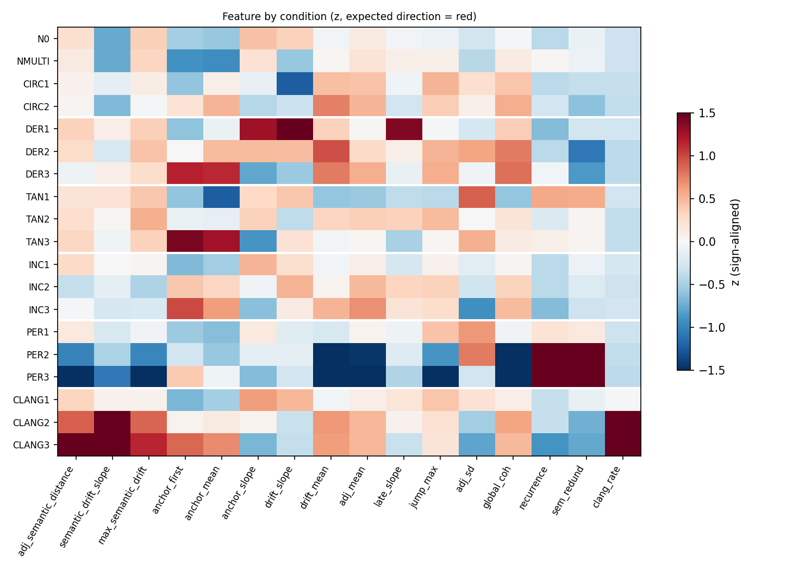

# v4 결과: 단계별 사고장애 발화로 지표 점검

재현: `python src/v4_judge.py --model gpt-4.1`, `python src/v4_features.py`. 계획: [00_plan.md](00_plan.md).

## 1. 생성기 검증 (GPT-4.1 블라인드 평가, 발화 114개 = 질문 6개 × 조건 19개)

해당 항목 점수 평균 (0~3):

| type   |   1.0 |   2.0 |   3.0 |
|:-------|------:|------:|------:|
| CLANG  |  1.17 |  3.00 |  3.00 |
| DER    |  0.17 |  1.17 |  2.33 |
| INC    |  0.33 |  1.17 |  2.83 |
| PER    |  0.17 |  1.17 |  3.00 |
| TAN    |  0.17 |  1.17 |  2.00 |

정상·대조 조건:

| cond   |   overall_disorganization |   circumstantiality |
|:-------|--------------------------:|--------------------:|
| CIRC1  |                      0.00 |                1.00 |
| CIRC2  |                      0.33 |                1.33 |
| N0     |                      0.00 |                0.00 |
| NMULTI |                      0.00 |                0.33 |

의도한 단계와 전체 와해 점수의 Spearman ρ = 0.89 (사고장애 5종 + N0).

## 2. 지표 판정 (탈선·주제 이탈·지리멸렬 + N0, n = 60)

통과 = 예상 방향 ρ ≥ 0.4 이고 NMULTI·CIRC1·CIRC2가 모두 DER2·TAN2 평균보다 낮음(예상 방향 기준).

| feature               | family   |   rho |    p |   rho_DER |   rho_TAN |   rho_INC | spec   | passed   |
|:----------------------|:---------|------:|-----:|----------:|----------:|----------:|:-------|:---------|
| adj_semantic_distance | TF-IDF   | -0.26 | 0.05 |     -0.24 |      0.12 |     -0.66 | True   | False    |
| semantic_drift_slope  | TF-IDF   |  0.13 | 0.33 |      0.46 |      0.23 |      0.10 | True   | False    |
| max_semantic_drift    | TF-IDF   | -0.19 | 0.14 |     -0.10 |      0.05 |     -0.62 | True   | False    |
| anchor_first          | SBERT    |  0.70 | 0.00 |      0.67 |      0.66 |      0.67 | False  | False    |
| anchor_mean           | SBERT    |  0.68 | 0.00 |      0.74 |      0.65 |      0.53 | False  | False    |
| anchor_slope          | SBERT    | -0.52 | 0.00 |     -0.45 |     -0.40 |     -0.51 | True   | False    |
| drift_slope           | SBERT    | -0.29 | 0.02 |     -0.42 |     -0.15 |     -0.12 | True   | False    |
| drift_mean            | SBERT    |  0.39 | 0.00 |      0.71 |      0.17 |      0.45 | False  | False    |
| adj_mean              | SBERT    |  0.35 | 0.01 |      0.27 |      0.10 |      0.51 | False  | False    |
| late_slope            | SBERT    | -0.08 | 0.53 |     -0.19 |     -0.10 |      0.21 | True   | False    |
| jump_max              | SBERT    |  0.32 | 0.01 |      0.45 |      0.25 |      0.26 | False  | False    |
| adj_sd                | SBERT    | -0.05 | 0.71 |      0.26 |      0.19 |     -0.39 | True   | False    |
| global_coh            | SBERT    | -0.48 | 0.00 |     -0.82 |     -0.37 |     -0.59 | False  | False    |
| recurrence            | SBERT    |  0.05 | 0.68 |      0.28 |      0.15 |     -0.18 | False  | False    |
| sem_redund            | SBERT    | -0.32 | 0.01 |     -0.74 |      0.06 |     -0.42 | False  | False    |
| mattr                 | SBERT    | -0.28 | 0.03 |     -0.84 |     -0.36 |      0.17 | False  | False    |
| sem_density           | SBERT    | -0.30 | 0.02 |     -0.31 |     -0.36 |     -0.24 | False  | False    |
| rare_rate             | SBERT    | -0.08 | 0.54 |     -0.02 |     -0.02 |     -0.17 | False  | False    |
| clang_rate            | SBERT    | -0.25 | 0.05 |     -0.41 |     -0.23 |      0.02 | False  | False    |

TF-IDF 3개는 팀 노트북과 같이 40토큰 창(20토큰씩 이동)을 답변 전체에 적용하고, TF-IDF는 답변 하나의 창들로 학습한다.

보속·음향 연상 전용 지표 (해당 조건 + N0). 음향 연상은 생성기 검증의 단계 순서 기준(1 < 2 < 3)을 통과하지 못했다(2단계와 3단계가 모두 3점). 아래 음향 연상 행은 참고값이다:

| condition   | feature    |   rho |    p |
|:------------|:-----------|------:|-----:|
| PER         | recurrence |  0.82 | 0.00 |
| PER         | sem_redund |  0.88 | 0.00 |
| CLANG       | clang_rate |  0.92 | 0.00 |

## 3. DAIS-C (같은 사람 안 비교, 예비)

통과한 SBERT 피처: 없음. 앞 40 내용어 안에 DT 표시가 있는 답변과 없는 답변을 둘 다 가진 화자만 사용.

해당 없음 (계획대로 분석하지 않음)

**계획 외 탐색**: 민감도만 통과한 지표(anchor_first, anchor_mean, global_coh)로 같은 비교. 조건을 만족하는 화자 7명(DT 답변 14개)뿐이라 판단 근거가 되지 못한다.

| feature      |   speakers |   dt_higher |   sign_p |   median_diff |
|:-------------|-----------:|------------:|---------:|--------------:|
| anchor_first |          7 |           2 |     0.45 |         -0.03 |
| anchor_mean  |          7 |           2 |     0.45 |         -0.01 |
| global_coh   |          7 |           3 |     1.00 |         -0.00 |

## 4. 해석

조건별 평균 (주요 지표):

| cond   |   semantic_drift_slope |   max_semantic_drift |   drift_slope |   anchor_mean |   global_coh |
|:-------|-----------------------:|---------------------:|--------------:|--------------:|-------------:|
| N0     |                  0.144 |                0.958 |         0.017 |         0.770 |        0.213 |
| NMULTI |                  0.144 |                0.956 |        -0.003 |         0.741 |        0.195 |
| CIRC1  |                  0.162 |                0.945 |        -0.018 |         0.825 |        0.162 |
| CIRC2  |                  0.147 |                0.939 |         0.002 |         0.859 |        0.146 |
| DER1   |                  0.169 |                0.958 |         0.043 |         0.809 |        0.166 |
| DER2   |                  0.159 |                0.962 |         0.019 |         0.856 |        0.119 |
| DER3   |                  0.168 |                0.954 |        -0.003 |         0.909 |        0.114 |
| TAN1   |                  0.172 |                0.961 |         0.018 |         0.717 |        0.276 |
| TAN2   |                  0.166 |                0.968 |         0.001 |         0.807 |        0.187 |
| TAN3   |                  0.164 |                0.958 |         0.014 |         0.920 |        0.194 |
| INC1   |                  0.166 |                0.942 |         0.014 |         0.775 |        0.204 |
| INC2   |                  0.162 |                0.914 |         0.020 |         0.842 |        0.170 |
| INC3   |                  0.159 |                0.927 |         0.012 |         0.868 |        0.154 |

- **이탈 기울기는 사고장애의 정도를 따라가지 않는다.** SBERT 기울기는 오히려 반대 방향이다(ρ = -0.29). 와해된 발화는 처음부터 거리가 높아 "점점 멀어지는" 기울기가 생기지 않는다. 이 지표는 점점 멀어지는 정도를 재는데, 교과서적 탈선과 지리멸렬은 처음부터 멀다.
- **TF-IDF 기울기는 탈선에서만 예상 방향이었다**(ρ_DER = 0.46, 전체 ρ = 0.13). 한 답변 안의 40토큰 창들은 겹치지 않는 부분끼리 같은 단어를 거의 공유하지 않아, 첫 창과의 거리가 정상 답변에서도 천장 근처다(max_semantic_drift N0 0.958). 그래서 이 지표는 의미보다 단어가 다시 나오는지에 좌우된다.
- **질문 기준 거리(anchor)는 단계를 잘 따라간다**(ρ ≈ 0.7). 하지만 우회증 2단계(0.859)가 탈선 2단계와 주제 이탈 2단계의 평균(0.831)보다 커서 특이도에서 탈락했다. 앞 40 내용어만 보면 "결국 질문에 답하는 장황한 말"과 "벗어나는 말"을 가를 수 없다. 우회증은 끝에서 질문으로 돌아오는 것이 특징이라 답변 전체를 봐야 한다.
- **전체 응집성(global_coh)**도 단계를 따라가지만(ρ = -0.48) 같은 이유로 우회증과 겹친다.
- **TF-IDF 지표 3개는 의미가 아니라 단어 반복에 반응한다.** 같은 말을 반복하는 보속 조건에서는 크게 낮아지고, 새 단어를 계속 쓰는 음향 연상 조건에서는 높아진다(그림의 왼쪽 세 열).
- **보속·음향 연상 전용 지표**는 해당 조건을 잘 따라간다. 다만 생성 발화가 반복과 운율을 글자 그대로 넣었기 때문에 당연한 결과에 가깝다.
- 정리: 지금 지표 중 이탈 기울기는 와해된 언어의 지표로 쓰기 어렵다. 질문 기준 거리가 가장 유망하지만, 우회증과 구분하려면 답변 끝부분이 질문으로 돌아오는지를 함께 봐야 한다.

## 5. 한계

- 생성 발화는 Claude가 작성하고 GPT-4.1이 평가했다. 둘 다 LLM이라 교과서 정의에 맞는지까지만 확인되고, 실제 환자 발화와 비슷한지는 확인되지 않는다.
- 조건마다 질문 6개(발화 6개)라 수치의 변동이 크다.
- 1단계는 GPT가 거의 0점으로 평가해(0.2~0.3), 사실상 0~3단계 중 0·2·3단계만 구분된다.
- 음향 연상 2·3단계는 GPT 평가가 모두 3점으로 구분되지 않았다.
- SBERT 지표는 앞 40 내용어로 계산해, 답변에서 차지하는 비율이 조건마다 다르다(대부분 절반 정도, 음향 연상 3단계는 약 3분의 1).
