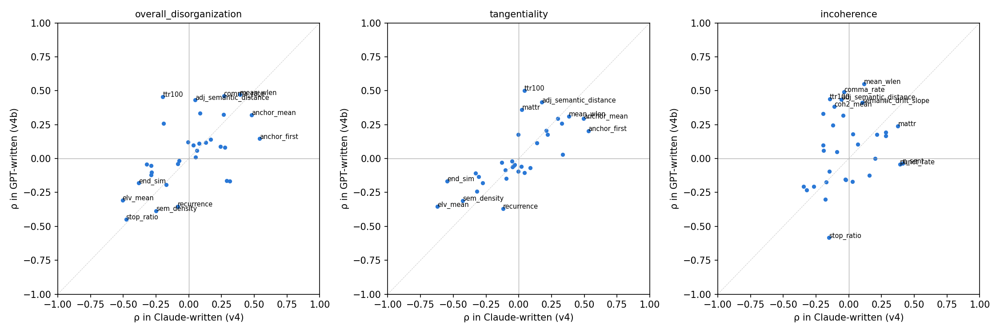

# v4c 사후 탐색: 두 생성 모델의 발화 모두에서 작동하는 지표

재현: `python src/v4c_robust.py`. Claude 작성 v4 114개, GPT 작성 v4b 152개. 정답은 두 세트 모두 **GPT-4.1 블라인드 평가**(같은 평가자, 같은 기준표). 결과를 본 뒤의 탐색이다.

## 0. 평가자 일치도 (v4b, GPT vs Claude 평가)

|                         |   ρ (GPT vs Claude) |
|:------------------------|--------------------:|
| derailment              |                0.68 |
| tangentiality           |                0.51 |
| incoherence             |                0.85 |
| perseveration           |                0.60 |
| clanging                |                0.90 |
| circumstantiality       |                0.09 |
| overall_disorganization |                0.81 |

## A. 세트별 평가 점수와의 Spearman ρ (_C = Claude 작성, _G = GPT 작성)

두 세트에서 방향이 같고 둘 다 |ρ| ≥ 0.3인 지표:

- **overall_disorganization**: anchor_mean, elv_mean, stop_ratio, mean_wlen
- **tangentiality**: sem_density, elv_mean, mean_wlen
- **derailment**: sem_density
- **incoherence**: 없음
- **perseveration**: mattr, coh1_mean, coh1_min, coh2_mean, comma_rate
- **clanging**: sem_density, clang_rate, stop_ratio, comma_rate
- **circumstantiality**: n_sent, punct_rate

| feature               |   over_C |   over_G |   tang_C |   tang_G |   dera_C |   dera_G |   inco_C |   inco_G |   pers_C |   pers_G |   clan_C |   clan_G |   circ_C |   circ_G |
|:----------------------|---------:|---------:|---------:|---------:|---------:|---------:|---------:|---------:|---------:|---------:|---------:|---------:|---------:|---------:|
| drift_slope           |    -0.07 |    -0.02 |    -0.10 |    -0.09 |    -0.01 |     0.02 |     0.03 |    -0.17 |    -0.20 |    -0.13 |    -0.05 |     0.03 |     0.02 |     0.11 |
| drift_mean            |     0.28 |     0.08 |     0.34 |     0.03 |     0.39 |     0.06 |     0.16 |    -0.12 |    -0.10 |    -0.17 |     0.25 |     0.08 |     0.23 |     0.20 |
| adj_mean              |     0.17 |     0.14 |     0.22 |     0.18 |     0.27 |     0.24 |     0.28 |     0.17 |    -0.15 |    -0.33 |     0.15 |    -0.05 |     0.06 |     0.08 |
| late_slope            |    -0.08 |    -0.04 |    -0.05 |    -0.02 |     0.04 |    -0.02 |    -0.02 |    -0.16 |    -0.11 |     0.02 |    -0.03 |    -0.00 |     0.05 |     0.10 |
| jump_max              |     0.06 |     0.06 |     0.14 |     0.11 |     0.19 |     0.15 |     0.07 |     0.10 |    -0.14 |    -0.23 |     0.11 |    -0.07 |     0.12 |     0.09 |
| adj_sd                |    -0.17 |    -0.19 |    -0.10 |    -0.15 |    -0.07 |    -0.20 |    -0.27 |    -0.21 |    -0.16 |     0.16 |    -0.13 |    -0.11 |     0.23 |     0.09 |
| global_coh            |    -0.29 |    -0.05 |    -0.31 |    -0.13 |    -0.39 |    -0.15 |    -0.20 |     0.10 |     0.14 |     0.47 |    -0.22 |    -0.02 |    -0.23 |    -0.24 |
| sem_redund            |    -0.29 |    -0.10 |    -0.27 |    -0.18 |    -0.34 |    -0.14 |    -0.19 |     0.06 |     0.08 |     0.39 |    -0.34 |    -0.12 |    -0.15 |    -0.25 |
| recurrence            |    -0.08 |    -0.35 |    -0.12 |    -0.37 |    -0.15 |    -0.40 |    -0.32 |    -0.23 |     0.18 |     0.29 |    -0.25 |    -0.22 |     0.10 |    -0.15 |
| mattr                 |    -0.19 |     0.26 |     0.02 |     0.36 |    -0.05 |     0.34 |     0.37 |     0.24 |    -0.38 |    -0.33 |     0.01 |     0.01 |    -0.19 |     0.19 |
| sem_density           |    -0.25 |    -0.39 |    -0.43 |    -0.31 |    -0.37 |    -0.38 |    -0.18 |    -0.30 |     0.07 |     0.13 |    -0.33 |    -0.44 |    -0.11 |    -0.09 |
| rare_rate             |     0.05 |     0.01 |     0.09 |    -0.07 |    -0.06 |    -0.03 |    -0.03 |    -0.15 |     0.03 |    -0.07 |     0.22 |     0.39 |     0.07 |     0.08 |
| clang_rate            |     0.13 |     0.12 |    -0.03 |    -0.05 |    -0.12 |     0.05 |     0.20 |     0.00 |     0.27 |     0.01 |     0.63 |     0.54 |    -0.37 |    -0.10 |
| anchor_first          |     0.54 |     0.15 |     0.53 |     0.20 |     0.50 |     0.15 |     0.28 |     0.19 |     0.15 |    -0.06 |     0.06 |     0.04 |     0.05 |     0.01 |
| anchor_mean           |     0.48 |     0.32 |     0.49 |     0.30 |     0.47 |     0.26 |     0.22 |     0.18 |     0.06 |    -0.07 |     0.07 |     0.18 |     0.18 |     0.17 |
| anchor_slope          |    -0.32 |    -0.04 |    -0.33 |    -0.11 |    -0.22 |    -0.03 |    -0.17 |    -0.17 |    -0.20 |    -0.01 |    -0.04 |    -0.02 |     0.05 |     0.08 |
| adj_semantic_distance |     0.05 |     0.43 |     0.18 |     0.41 |     0.09 |     0.51 |    -0.06 |     0.44 |    -0.06 |    -0.21 |     0.53 |     0.20 |    -0.10 |     0.05 |
| semantic_drift_slope  |     0.27 |     0.32 |     0.33 |     0.26 |     0.26 |     0.35 |     0.10 |     0.41 |     0.16 |     0.02 |     0.49 |     0.23 |     0.01 |    -0.13 |
| max_semantic_drift    |     0.08 |     0.33 |     0.30 |     0.29 |     0.17 |     0.41 |    -0.12 |     0.24 |    -0.08 |    -0.23 |     0.43 |     0.23 |     0.10 |     0.19 |
| elv_slope             |     0.24 |     0.09 |     0.21 |     0.21 |     0.12 |     0.11 |     0.03 |     0.18 |     0.21 |     0.00 |     0.01 |    -0.04 |     0.02 |    -0.06 |
| elv_mean              |    -0.51 |    -0.31 |    -0.62 |    -0.35 |    -0.54 |    -0.26 |    -0.15 |    -0.09 |    -0.02 |     0.11 |    -0.08 |    -0.14 |    -0.34 |    -0.24 |
| coh1_mean             |     0.04 |     0.10 |     0.02 |    -0.06 |    -0.15 |     0.06 |    -0.20 |     0.33 |     0.39 |     0.53 |     0.09 |    -0.03 |    -0.05 |    -0.18 |
| coh1_min              |     0.08 |     0.11 |    -0.04 |    -0.05 |    -0.11 |     0.08 |    -0.04 |     0.32 |     0.37 |     0.49 |     0.13 |     0.00 |    -0.26 |    -0.22 |
| coh1_sd               |    -0.29 |    -0.12 |    -0.05 |    -0.06 |    -0.15 |    -0.14 |    -0.35 |    -0.21 |    -0.22 |    -0.04 |    -0.16 |    -0.12 |     0.27 |     0.14 |
| coh2_mean             |    -0.01 |     0.12 |    -0.13 |    -0.03 |    -0.26 |     0.07 |    -0.11 |     0.38 |     0.47 |     0.54 |     0.13 |    -0.00 |    -0.16 |    -0.20 |
| end_sim               |    -0.38 |    -0.18 |    -0.55 |    -0.17 |    -0.38 |    -0.14 |    -0.09 |     0.05 |    -0.08 |     0.03 |    -0.16 |    -0.07 |    -0.01 |    -0.07 |
| n_sent                |     0.29 |    -0.16 |    -0.00 |    -0.10 |    -0.08 |    -0.13 |     0.41 |    -0.03 |     0.53 |    -0.03 |     0.33 |     0.22 |    -0.54 |    -0.32 |
| ttr100                |    -0.20 |     0.46 |     0.04 |     0.50 |    -0.15 |     0.54 |    -0.15 |     0.44 |    -0.17 |    -0.22 |     0.40 |     0.05 |    -0.02 |     0.21 |
| stop_ratio            |    -0.48 |    -0.45 |    -0.32 |    -0.24 |    -0.21 |    -0.48 |    -0.15 |    -0.58 |    -0.50 |    -0.22 |    -0.47 |    -0.37 |     0.12 |     0.15 |
| mean_wlen             |     0.39 |     0.47 |     0.38 |     0.31 |     0.22 |     0.49 |     0.12 |     0.55 |     0.32 |     0.23 |     0.34 |     0.22 |    -0.02 |    -0.07 |
| punct_rate            |     0.31 |    -0.17 |     0.04 |    -0.11 |    -0.04 |    -0.14 |     0.39 |    -0.04 |     0.52 |    -0.03 |     0.29 |     0.25 |    -0.49 |    -0.32 |
| comma_rate            |     0.27 |     0.46 |    -0.00 |     0.18 |    -0.01 |     0.40 |    -0.04 |     0.49 |     0.51 |     0.51 |     0.55 |     0.42 |    -0.03 |    -0.06 |

## B. 세트 차이 대 사고장애 효과 (Cohen's d)

gen_d = 사고장애 없는 발화(N0·NMULTI·CIRC)에서 GPT 세트 − Claude 세트(생성 모델, 인물, 질문이 모두 다름). dis_d = 세트 안에서 전체 와해 ≥ 2 대 0. ratio = |gen_d| / (두 dis_d 중 작은 절댓값). ratio가 1보다 크면 같은 정상 발화끼리의 문체 차이가 사고장애로 인한 차이보다 크다.

|                       |   gen_d |   dis_d_Claude |   dis_d_GPT |   ratio | dis_부호일치   |
|:----------------------|--------:|---------------:|------------:|--------:|:---------------|
| n_sent                |    0.00 |           0.58 |       -0.33 |    0.00 | False          |
| coh1_mean             |   -0.03 |           0.36 |        0.56 |    0.10 | True           |
| punct_rate            |   -0.04 |           0.63 |       -0.33 |    0.12 | False          |
| ttr100                |    0.10 |          -0.47 |        1.05 |    0.20 | False          |
| anchor_first          |   -0.06 |           1.52 |        0.27 |    0.24 | True           |
| clang_rate            |   -0.30 |           0.86 |        0.93 |    0.35 | True           |
| mattr                 |    0.17 |          -0.87 |        0.41 |    0.41 | False          |
| end_sim               |   -0.12 |          -0.93 |       -0.24 |    0.48 | True           |
| stop_ratio            |    0.59 |          -1.21 |       -2.59 |    0.49 | True           |
| comma_rate            |    0.70 |           1.15 |        2.01 |    0.60 | True           |
| recurrence            |   -0.08 |           0.13 |       -0.57 |    0.64 | False          |
| mean_wlen             |   -0.62 |           0.96 |        2.06 |    0.65 | True           |
| adj_semantic_distance |   -0.16 |          -0.24 |        0.84 |    0.69 | False          |
| adj_sd                |   -0.29 |          -0.42 |       -0.53 |    0.70 | True           |
| coh1_min              |    0.33 |           0.44 |        0.62 |    0.74 | True           |
| coh2_mean             |    0.27 |           0.34 |        0.64 |    0.80 | True           |
| coh1_sd               |   -0.37 |          -0.61 |       -0.40 |    0.93 | True           |
| drift_mean            |   -0.03 |           0.03 |        0.05 |    0.93 | True           |
| late_slope            |   -0.24 |          -0.23 |       -0.24 |    1.08 | True           |
| max_semantic_drift    |   -0.30 |          -0.27 |        0.55 |    1.13 | False          |
| semantic_drift_slope  |   -0.92 |           0.70 |        1.35 |    1.32 | True           |
| sem_density           |   -0.29 |           0.21 |       -1.05 |    1.34 | False          |
| elv_mean              |    0.62 |          -1.29 |       -0.45 |    1.38 | True           |
| anchor_mean           |   -0.63 |           1.19 |        0.45 |    1.40 | True           |
| adj_mean              |    0.15 |          -0.10 |        0.35 |    1.51 | False          |
| elv_slope             |   -0.35 |           0.54 |        0.21 |    1.65 | True           |
| drift_slope           |    0.33 |          -0.14 |       -0.16 |    2.37 | True           |
| global_coh            |    0.11 |           0.04 |       -0.11 |    2.52 | False          |
| anchor_slope          |    0.40 |          -0.78 |       -0.14 |    2.78 | True           |
| jump_max              |    0.18 |          -0.29 |        0.05 |    3.67 | False          |
| rare_rate             |    0.47 |           0.36 |        0.12 |    3.91 | True           |
| sem_redund            |    0.23 |          -0.04 |       -0.21 |    5.73 | True           |

dis_부호일치가 False인 지표는 두 세트에서 사고장애 효과의 방향이 반대라 ratio가 작아도 안정적이지 않다. Cohen's d는 표본 수로 가중한 합동 표준편차를 쓴다. 이 비교는 생성 모델, 인물, 질문이 함께 다른 두 세트를 비교한 것이라, 생성 모델 효과만 분리한 결과는 [08_generator.md](08_generator.md)에 있다.

## C. 교차 예측 (Ridge, 한 세트로 학습해 다른 세트의 평가 점수와 Spearman ρ)

모든 묶음에서 같은 항목으로 비교하도록, 지표 중 하나라도 결측인 발화(문장이 3개 미만이라 문장 응집성을 계산할 수 없는 발화)는 미리 뺐다(Claude 109개, GPT 139개).

| 지표묶음    | 목표                    |   Claude_to_GPT |   GPT_to_Claude |
|:------------|:------------------------|----------------:|----------------:|
| 전체 지표   | overall_disorganization |            0.46 |            0.41 |
| 전체 지표   | tangentiality           |            0.37 |            0.50 |
| 전체 지표   | incoherence             |            0.17 |            0.30 |
| 문체 제외   | overall_disorganization |            0.35 |            0.24 |
| 문체 제외   | tangentiality           |            0.36 |            0.48 |
| 문체 제외   | incoherence             |           -0.11 |           -0.05 |
| 질문 기준만 | overall_disorganization |            0.25 |            0.48 |
| 질문 기준만 | tangentiality           |            0.29 |            0.63 |
| 질문 기준만 | incoherence             |            0.15 |            0.25 |
| 문체만      | overall_disorganization |            0.35 |            0.10 |
| 문체만      | tangentiality           |            0.30 |            0.21 |
| 문체만      | incoherence             |            0.31 |            0.11 |

## 해석

- **모든 사고장애 종류와 두 생성 모델에서 함께 작동하는 단일 지표는 없다.** 전체 와해에서 두 세트 모두 |ρ| ≥ 0.3인 지표는 질문 기준 지표 2개(elv_mean, anchor_mean)와 문체 지표 2개(stop_ratio, mean_wlen)뿐이다. 지리멸렬은 두 세트에서 함께 작동하는 지표가 없다.
- **사고장애 종류마다 맞는 지표가 다르다.** 질문 기준 지표는 주제 이탈·탈선, 반복 지표(mattr, 문장 응집성)는 보속, clang_rate는 음향 연상을 잡는다. 하나의 "이탈 점수"로 와해된 언어 전체를 재려는 설계 자체가 맞지 않는다.
- **질문 기준 지표는 세트에 따라 기준점이 움직인다.** 사고장애가 없는 발화끼리도 두 세트의 elv_mean 차이(d = 0.62)가 GPT 세트 안의 사고장애 차이(d = -0.45)보다 크다. 다만 두 세트는 생성 모델, 인물, 질문이 모두 달라 이 차이를 생성 모델 탓으로 돌릴 수 없다. 인물과 질문을 맞춘 비교([08_generator.md](08_generator.md))에서는 생성 모델 효과가 사고장애 효과보다 작았다. GPT 세트의 사고장애 효과가 작게 잡힌 것은 그 세트에서 사고장애 단계가 제대로 나뉘지 않은 탓도 있다. 출처가 다른 데이터를 하나의 기준값으로 비교하지 말고, 같은 사람, 같은 면담 안에서 비교하거나 데이터마다 정상 대조군으로 기준을 맞춰야 한다는 결론은 유지된다.
- **교차 예측은 중간 수준이다**(전체 지표 ρ 0.46, 0.41). 질문 기준 지표만으로는 GPT → Claude 방향이 더 잘 된다(전체 와해 0.48, 주제 이탈 0.63, 반대 방향 0.25, 0.29). 지리멸렬은 어느 묶음으로도 잘 옮겨지지 않았고(최대 0.31), 의미 지표만으로는 0 근처다(문체 제외 -0.11, -0.05).
- **평가자 사이에서도 주제 이탈(ρ = 0.51)과 우회증(0.09)은 일치도가 낮다.** 정답 자체가 흔들리는 항목이라, 이 두 항목에서 지표가 약하게 나오는 일부는 평가의 한계다.
