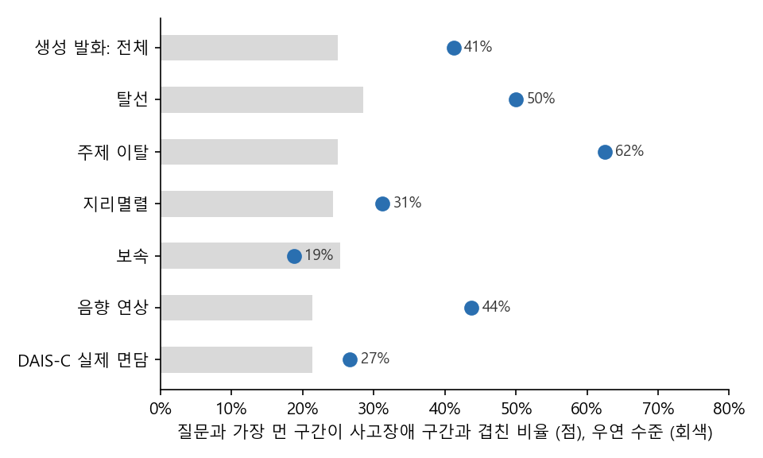

# v4f: 미묘한 국소 사고장애와 구간 지표

재현: `python src/v4f_generate.py`, `python src/v4f_local.py`. 계획: [00_plan.md](00_plan.md) 'v4f 계획'.

GPT-4.1 작성 112개 = 질문 8 × 조건 7(N0, CIRC, 국소 DER·TAN·INC·PER·CLANG) × 2회. 국소 조건은 답변 대부분이 정상이고 한두 문장(표시 구간 내용어 중앙값 13개, 답변 내용어 중앙값 76개)만 사고장애다. 지표는 내용어 기준 5개 창.

## 0. 생성 검증: 조건 모르는 평가자 (Claude 에이전트, 표시 괄호를 지운 112개를 섞어 평가)

평가 기준은 v4·v4b와 같은 TLC 요약이고, 가장 이상한 한두 문장을 그대로 옮겨 적게 했다. '표시구간과_겹침'은 평가자가 옮겨 적은 구간이 생성 때 표시한 구간과 겹친 비율이다.

| 조건   |     n |   전체와해_평균 |   전체와해_1점이상 |   해당항목_1점이상 |   탈선항목_1점이상 |   평가자구간_있음 |   표시구간과_겹침 |
|:-------|------:|----------------:|-------------------:|-------------------:|-------------------:|------------------:|------------------:|
| N0     | 16.00 |            0.00 |               0.00 |             nan    |               0.00 |              0.00 |            nan    |
| CIRC   | 16.00 |            0.00 |               0.00 |               0.94 |               0.00 |              0.00 |            nan    |
| DER    | 16.00 |            0.50 |               0.50 |               0.88 |               0.88 |              0.88 |              1.00 |
| TAN    | 16.00 |            0.50 |               0.50 |               0.00 |               0.75 |              0.75 |              1.00 |
| INC    | 16.00 |            2.00 |               1.00 |               1.00 |               0.00 |              1.00 |              1.00 |
| PER    | 16.00 |            1.00 |               1.00 |               1.00 |               0.00 |              1.00 |              1.00 |
| CLANG  | 16.00 |            1.00 |               0.94 |               1.00 |               0.00 |              1.00 |              1.00 |

- 정상과 우회증은 모두 0점이었고, 평가자가 이상한 구간을 고른 답변은 모두 표시 구간과 겹쳤다(74개). 표시 구간을 정답으로 써도 된다.
- 다만 미묘하게 쓴 만큼 탈선·주제 이탈은 절반만 전체 와해 1점 이상이었고, **국소 주제 이탈은 평가자가 '주제 이탈'이 아니라 '탈선'으로 봤다.** TLC에서 주제 이탈은 질문에 대한 답 전체가 비껴가는 것이라, 답변 중간 한두 문장의 이탈은 정의상 탈선에 가깝다.
- 평가자가 전체 와해 1점 이상으로 본 국소 답변 63개만으로 위치 맞히기를 다시 하면 q_min 창 적중 37%, 우연 24% (p = 0.019)로 결론이 같다.

## 1. 답변 수준: 같은 질문·회차의 정상(N0) 대비 예상 방향인 쌍의 수 (종류별 16쌍, ALL은 질문·회차별로 다섯 종류를 평균해 16쌍)

| feature   |   DER |   TAN |   INC |   PER |   CLANG |   ALL |   CIRC |
|:----------|------:|------:|------:|------:|--------:|------:|-------:|
| jump_max  |     8 |     8 |     7 |     4 |       4 |     5 |      7 |
| q_dip     |     8 |     7 |     7 |     8 |       5 |     6 |      5 |
| q_mean    |     9 |     8 |    13 |     7 |       8 |     9 |      9 |
| q_min     |     9 |     8 |     9 |     7 |       5 |     8 |      6 |

부호 검정 p:

| feature   |   DER |   TAN |   INC |   PER |   CLANG |   ALL |   CIRC |
|:----------|------:|------:|------:|------:|--------:|------:|-------:|
| jump_max  | 1.000 | 1.000 | 0.804 | 0.077 |   0.077 | 0.210 |  0.804 |
| q_dip     | 1.000 | 0.804 | 0.804 | 1.000 |   0.210 | 0.454 |  0.210 |
| q_mean    | 0.804 | 1.000 | 0.021 | 0.804 |   1.000 | 0.804 |  0.804 |
| q_min     | 0.804 | 1.000 | 0.804 | 0.804 |   0.210 | 1.000 |  0.454 |

CIRC 열은 우회증(대조)이 정상보다 '사고장애 쪽'으로 나온 쌍의 수다. 많을수록 우회증을 사고장애로 오인한다.

## 2. 위치: 지표가 고른 구간이 표시 구간과 겹치는 비율 (국소 사고장애 80개)

| 지표          |   n |   hit_rate |   chance |     p |
|:--------------|----:|-----------:|---------:|------:|
| q_min 창      |  80 |      0.412 |    0.249 | 0.001 |
| jump_max 경계 |  80 |      0.412 |    0.331 | 0.079 |

q_min 창의 종류별 적중:

| cond   |   n |   hit_rate |   chance |     p |
|:-------|----:|-----------:|---------:|------:|
| DER    |  16 |      0.500 |    0.285 | 0.057 |
| TAN    |  16 |      0.625 |    0.249 | 0.002 |
| INC    |  16 |      0.312 |    0.243 | 0.345 |
| PER    |  16 |      0.188 |    0.253 | 0.810 |
| CLANG  |  16 |      0.438 |    0.214 | 0.037 |

## 3. DAIS-C (생성 발화에서 통과한 지표: q_min)

같은 사람 안 DT 답변 대 일반 답변:

| feature   |   speakers |   expected |   sign_p |   wilcoxon_p |
|:----------|-----------:|-----------:|---------:|-------------:|
| q_min     |         13 |          8 |    0.581 |        0.635 |

DT 답변 안에서 위치 맞히기 (DT 답변 30개, 표시 구간은 첫 DT 단어부터 마지막 DT 단어까지):

| 지표          |   n |   hit_rate |   chance |     p |
|:--------------|----:|-----------:|---------:|------:|
| q_min 창      |  30 |      0.267 |    0.214 | 0.302 |
| jump_max 경계 |  30 |      0.267 |    0.266 | 0.565 |

## 4. 해석

- **사고장애가 미묘하고 일부 구간에만 있으면, 답변 단위 지표로는 정상 답변과 구분되지 않는다.** 다섯 종류를 평균해도 예상 방향인 쌍이 절반 안팎이었다(q_min 8/16, q_dip 6/16). 정상 답변에도 질문과 덜 관련된 구간이 늘 있어서, 짧은 이탈 하나는 그 변동에 묻힌다. DAIS-C에서 답변 단위 차이가 없었던 것(06)과 같은 현상이다.
- **위치는 어느 정도 맞힌다.** 답변 안에서 질문과 가장 먼 창(q_min)이 표시 구간과 겹친 비율은 41%로 우연 수준(25%)보다 높았다. 특히 주제 이탈(62%)과 탈선(50%)에서 높았고, 보속에서는 우연 수준 이하였다. "이 답변이 사고장애인가"는 못 가려도, "이상하다면 어디가 이상한가"는 일부 짚는다.
- **우회증을 사고장애로 오인하지는 않았다**(CIRC 열이 절반 안팎).
- **DAIS-C에서는 위치 맞히기도 우연 수준과 차이가 없었다**(표시 답변 30개). 실제 표시 구간은 첫 표시 단어부터 마지막 표시 단어까지로 넓게 잡혀 있고, 표시 기준도 알 수 없어 정답 자체가 거칠다. 또 DAIS-C의 질문은 직전 면담자 발화 전체라 생성 발화의 짧은 질문보다 길고 잡음이 많다.

